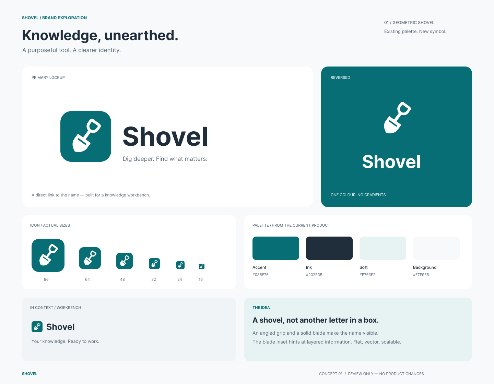

# Shovel logo

The approved **Knowledge, unearthed** design replaces the previous letter-S
mark with a geometric shovel. The angled handle and solid blade connect the
identity to the Shovel name; the blade inset suggests layers of knowledge.

## Design files

- [Original editable Figma document](https://www.figma.com/design/rYCWCGHeuITrOh4j2wzb0g?node-id=1-2)
- [Archived presentation, PNG](shovel-logo-preview.png)
- [Archived vector presentation, SVG](shovel-logo-design.svg)
- [Production logo, SVG](../../frontend/app/icon.svg)

The vector presentation was exported from Figma with outlined text so its
appearance does not depend on installed fonts. The Figma document retains
editable text and layers.

## Palette and use

| Role | Colour |
| --- | --- |
| Accent / logo tile | `#086e75` |
| Wordmark | `#202e3b` |
| Soft background | `#e7f3f2` |
| Workbench background | `#f7f9fb` |

Use the flat, single-colour symbol without gradients or shadows. Preserve the
square aspect ratio and scale strokes together with the artwork. Use the
white symbol on teal for the reversed treatment.

`frontend/app/icon.svg` is the canonical runtime asset. The sidebar brand and
all Shovel message headings (saved, pending and streaming replies) import that
same file, which also supplies the browser tab icon through Next.js metadata.
The existing wordmark text and localized accessible link labels are retained.
