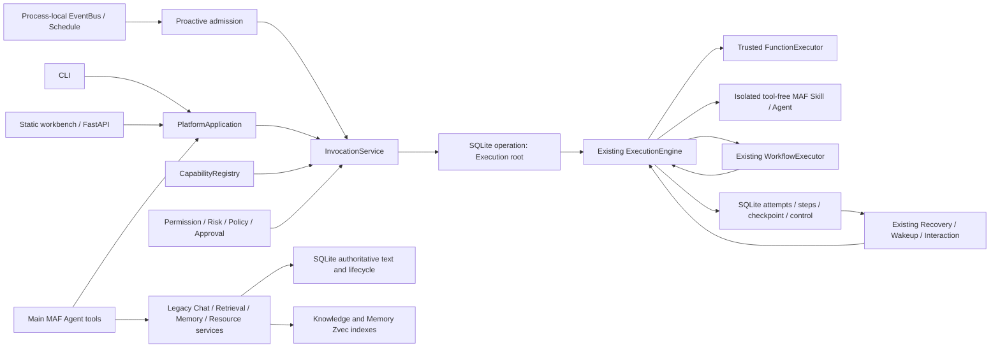
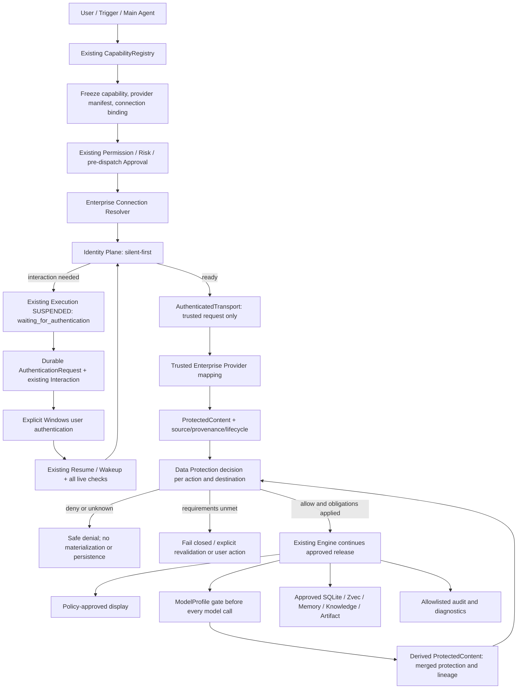

# Enterprise Security Foundation：ES-0 仓库分析

**状态：ES-0 分析完成；另行获准的 ES-2 契约、ES-3 配置管理和 ES-4
身份/认证/持久交互内核已实现。真实 WAM 和后续机制仍待分阶段验证，不启用企业执行。**

**ES-5 进度：用户另行选择隔离 Python WAM 验收 spike；已完成离线 SDK 检查，
尚未完成真实 Windows Broker 或生产接受性验证，见第 17 节。**

**ES-6 进度：另行获准的默认拒绝策略内核、受控消费及保守派生传播已实现，
见第 18 节；尚未接入现有 AG-UI/模型/存储出口，不代表 H1–H4 已通过。**

**ES-8 进度：已实施既有 Engine 的隔离只读企业 Function 集成、原子认证等待/
手动恢复、持久审计与完整 buffer 展示门控，见第 20 节。只装配 synthetic fixtures，
不启用生产 Provider、WAM、自动索引或既有 AG-UI/Memory 的企业数据入口。**

**ES-9 进度：已补齐离线安全/失败矩阵，新增 35 项回归并修复认证定时器及多源
generation 检查边界，见第 21 节。MCP 1.x/MAF 兼容约束已修正；不以离线测试替代
真实 WAM、组织批准或 H1–H4 的生产验收。**

需求依据为 `Documents\enterprise_security_foundation.md`，特别是其中的
ENT-SEC-01 至 ENT-SEC-18、分阶段实施要求和本轮十五项输出。
本报告配套 [Enterprise Security ADRs](enterprise_security_adrs.md)，不替代现有
[Platform Architecture](platform_architecture.md) 和
[Platform ADRs](platform_adrs.md) 中已经实施的决策。

## 1. 分析范围、证据与限制

代码基线为 `de91f40`。实际盘点到 187 个后端 Python 文件、34 个后端测试文件；
分析沿入口、依赖装配、调用、检查点、模型出站、数据写入、检索和恢复链路进行，
同时检查 ORM 注册、迁移、测试断言、前端约束和 CI/Release 配置。以下将“已实施”、
“ORM 脚手架”和“建议实施”分开，不把设计文档中的未来计划当成运行时能力。

实施期间未访问用户业务数据库、邮箱或企业账户，未登录、申请 Token 或调用真实企业
Provider；ES-5 认证依赖只安装于独立 spike 环境。ES-3/4 迁移仅在测试隔离数据库验证，不操作用户业务 stores。
SDK 依据来自官方公开文档和 PyPI 元数据；
wheel 存在不等于端到端集成通过。

工作区原有 `uv.lock` 修改和需求文件保持不变。ES-0/1 最初只新增本分析及配套 ADR；
ES-2 增加第 12 节的十二个 Python 文件；单独获准的 ES-3/4 范围见第 15–16 节。
不更新版本、用户配置、依赖或既有发布内容；复用现有 Runtime，生产认证保持 unavailable。

## 2. 当前架构地图

| 层/领域 | 实际组件与证据 | 企业安全实施应复用的边界 |
|---|---|---|
| 安装与入口 | `pyproject.toml:67` 的 CLI entry point；`backend\src\shovel\cli` 的 Typer 命令 | 不增加企业专用 Host 或第二套 CLI Runtime |
| Host 与 DI | `container.py:21` 的 `AppContainer`；`runtime\hosting.py:239` 的 `build_host`；`runtime\service.py:239` 的 `create_runtime` | dependency-injector 的配置、DB/session Resource、Runtime 生命周期及停机清理 |
| 后台维护 | `runtime\hosting.py:51,111,156,191` 的 Operation、Memory、Automation、Execution maintenance workers | 新的维护步骤加入现有 Host，不建立企业 Worker Runtime |
| 应用门面 | `platform\service.py:61` 的 `PlatformApplication`；`platform\agent_tools.py`；API 和 CLI adapters | 新能力通过同一门面、同一 Scope 和明确 human/agent 边界 |
| Capability | `capability\domain.py:208,241` 的 `CapabilityContent`、`FunctionContract`；`capability\registry.py:22` 的 `CapabilityRegistry` | trusted implementation ID、版本/hash/dependency lock、不可变发布及 availability |
| Invocation / Execution | `execution\invocation.py:46`；`execution\engine.py:32`；`db\execution_repository.py` | 唯一新 Execution 生命周期；root/child、预算、lease、幂等请求、dispatch receipts |
| Permission / Risk / Approval | `security\services.py:31,55,88,103,111,143,207` | 精确 permission 交集、side-effect risk floor、实时重查、单次审批消费 |
| Workflow | `workflow\executor.py:12`；`workflow\domain.py`；`db\workflow_repository.py` | serial DAG、持久检查点、同一 Engine 的 child 调用、Approval/Input/Output 节点 |
| Event / Proactive | `automation\events.py:13` 的 `InProcessEventBus`；`automation\manager.py`、`schedules.py` | matching/admission、revision/configuration freeze；当前 EventBus 不耐久 |
| Interaction / Notification | `interaction\service.py:61`；`db\model\interaction.py` | request fact 与 interaction projection、投递重试和既有唤醒机制 |
| 主 Agent / MAF | `runtime\agent.py:218,506,703`；`runtime\chat.py:218` | ContextProvider、MAF Agent/AgentSession、原生 compaction、AG-UI、预算及诊断 middleware |
| 版本化 Skill / Agent | `execution\executors.py:33,64` | 独立、无工具的 MAF Agents；不继承主 Agent 的 Memory、RAG 或扩展 |
| 扫描与 Knowledge | `pipeline\scan_service.py:687`；parser registry、chunker、embedder、sink、cleanup | discovery/fetch/parse/chunk/embed/persist/reconcile；不要复制整个 pipeline |
| Native Memory | `memory\domain.py`、`memory\service.py`、`memory\sqlite_repository.py:122`、`memory\zvec_index.py:30`；`runtime\memory_tasks.py:22` | SQLite 权威记录、revision、scope、epoch fences、原子 outbox、可重建索引 |
| SQLite | `db\database.py:29`；`db\unit_of_work.py:12`；`db\migrations.py:38` | WAL、foreign keys、BEGIN IMMEDIATE、显式 commit、版本化升级 |
| Zvec / 搜索 | `vector\schema.py:67,118`；`pipeline\sink.py:98`；`runtime\retrieval.py:45` | deterministic IDs、flush 后确认、候选回查 SQLite；索引不能授予权限 |
| 资源与凭据 | `services\connector_registry.py`；`services\credentials.py:64,162`；`db\model\config.py:15` | connector 实现目录与资源配置分离，CredentialRef/keyring；不是企业身份框架 |
| 前端 | `frontend\app\api.ts`、request recovery、static-export workbench；`frontend\AGENTS.md` | FastAPI 后端，统一 API helpers；不能通过 Next.js server actions 建认证后端 |

表中的后端路径均相对于 `backend\src\shovel`。



**唯一 Engine 的准确含义：**新 Capability/Workflow/Proactive 调用共享 Engine，
但 legacy Job、Chat、资源扫描及 Memory Operation 尚未全部迁入它。不能宣称当前
所有主 Agent 工具均已注册为 Capability，也不能为弥补这一差异再建企业 Engine。

### 2.1 实际领域模型与 ORM，不机械重复建表

* `capability_definition/version/dependency` 已承载定义、不可变内容及依赖。
  `operation.execution_data` 承载新 Execution snapshot，`execution_attempt/step`
  承载尝试和 dispatch 事实。没有独立 EnterpriseExecution 表的需求。
* `approval_request` 有 owner、execution、binding hash、有效期和单次消费约束；
  `input_request` 是 Workflow 输入事实，不是登录请求。
* `proactive_service` 有版本化配置；`execution_wakeup` 是 Execution timer，
  与业务 `schedule` 不同。
* `resource` 是 connector 实例，`identity_ref` 是 `keyring:`/`env:` 凭据引用；
  `domain\identity.py` 只有 `new_id`，不是 Entra IdentityProfile。
* `document/chunk` 是现有 Knowledge 文本和生命周期权威；`deletion_outbox`
  是索引删除意图。`memory_belief/episode/procedure`、Memory epoch/index outbox
  是现有 Native Memory 持久化基础。
* `DocumentDerived`、`BlobRef`、`AgentScope`、Entity/Fact 图模型已存在并在
  `db\model\__init__.py` 注册；源码引用检查中，前述前三项未发现运行服务读写路径。
  `BlobRef` 不是已完成的 secure Artifact Store，Entity 图也不是数据派生 lineage。
  `AgentScope` 的说明不能证明现有搜索执行了它的授权。
* `RetrievalLog` 实际由搜索写入，保存 query text 和命中 ID/score，不保存本次
  returned passage 正文；ChatMessage 则保存正文及包含引用的结果。
  Memory revision log、Execution facts、Approval receipts 不等于统一 Security Audit。

## 3. 文件级缺口与具体接入点

| 当前文件/类 | 已有行为或缺口 | 最小后续变化，不在本轮实施 |
|---|---|---|
| `runtime\service.py:83,128` | 生产 `CapabilityRegistry` 没有安装 Function contracts，`FunctionExecutor({})` handler map 为空 | 原子安装 trusted manifest、FunctionContract 与 handler；仍由既有 Registry/Engine 执行 |
| `capability\domain.py:105` / `ConnectionRequirement` | 只有 name 和安全 connection ref，无 tenant/cloud/profile/manifest 解析 | 接入强类型 ConnectionProfile resolver，不把 ref 当 Credential |
| `security\services.py:103` / `PolicyEvaluator` | 明确拒绝 connection-backed execution；它是 capability side-effect policy，不是 DLP | 仅对完整验证、已安装的企业绑定解除该项拒绝；其余继续 deny |
| `execution\domain.py:26,203,257` | 六个生命周期状态，generic JSON input/output/checkpoint，无认证等待或保护类型 | 保持物理 `SUSPENDED`，增加受控 auth wait projection/fact；持久层仅接受获准引用 |
| `execution\engine.py:32` | auth 异常会落入一般失败；dispatch 事实先于 executor 内部 HTTP | 专门分类 auth wait；记录实际 outbound effect 阶段，避免错误 replay |
| `db\execution_repository.py` / control repository | frozen snapshots、lease、resume、deadline 已可靠存在，但不验证企业 principal/source/policy | admission、dispatch、resume、完成写入处验证企业 binding/generation；不延长旧 deadline |
| `workflow\executor.py:30,93` | mappings、node values、outputs 直接传递/保存 JSON；Condition 可读取普通值 | 企业引用保持标签；即使 Condition/Notification/Input/Output 也要评估 PROCESS/DISPLAY/PERSIST |
| `execution\executors.py:33,64` | JSON input 直接发 MAF，结果为普通 text JSON | 输入 materialization 和模型 HTTP 前置 gate；输出为继承 lineage 的 ProtectedContent/ref |
| `runtime\agent.py:270,830` | history、summary、Memory、RAG、MCP/工具结果进入模型；预算 middleware 不是 DLP | 在所有模型出站而非仅一个工具回调处强制 gate；覆盖 compaction、recovery 和后续工具回合 |
| `runtime\chat.py:250,286` | 用户消息/标题先写 SQLite；答案、citations、summary tasks 随后写入 | 企业 ingress、DISPLAY、PERSIST、summary lineage 都须 gate；不能靠关闭长期 Memory 解决 |
| `runtime\agent_extensions.py:118` | MCP 及可选 Python/Pipeline 路径不经过 Capability Engine | 企业数据不得经未受控扩展出站；受保护模式下拒绝未纳管出口，不能把 Python 插件当沙箱 |
| `runtime\model_admission.py:37,164` | 管理本地模型并发/优先级，不判断分类、tenant 或目的地 | 在调度 transport 之外组合 protection transport；本机 Ollama 也不自动 ALLOW |
| `pipeline\scan_service.py:687,756,805` | 普通 bytes/text 进入 parse、embed、SQLite；部分 source hash 为长度提示 | 企业路径先取可信元数据、逐动作 gate，并使用可信 source version/digest；不复用弱版本假设 |
| `vector\schema.py:67` / `ZvecChunkSink` | Knowledge Zvec schema/sink 包含全文 text；无 tenant/protection binding | 企业独立安全 collection/generation 无默认正文；复用 Zvec 基础设施，不改写旧 personal schema |
| `runtime\retrieval.py:119,194,310` | 已回查 resource state、document revision/index hash；仍返回裸 text、记录 query | 增加 identity/connection/authorization freshness/protection/lifecycle gate；keyword/parent expansion 同样覆盖 |
| `memory\domain.py:43,106` / `runtime\memory.py:54` | MemoryScope 不含企业 tenant/connection，运行 owner 默认 local-user；platform user 默认 owner | 显式绑定两种身份命名空间，不自动改写旧 scope；企业 Memory 强制 source/protection sidecar |
| `memory\service.py` / SQLite/Zvec adapters | personal 过滤、去重、epoch fences、SQLite fallback 已存在，无企业 policy/lineage | 复用写入/outbox/fence 机制；所有 enterprise read/write/fallback/rebuild 必须绑定保护 |
| `automation\events.py:13` | bounded process-local queue，publish 不证明耐久 | 增加 SQLite lifecycle fact/outbox 与匹配后的幂等 admission receipts；复用当前 bus/matching |
| `interaction\service.py:61` / ORM | actions/kind/channel 有有限集合和 SQL CHECK；InputRequest owner trigger 限 Workflow | 新 AuthenticationRequest 事实和 AUTHENTICATE action；更新旧 projection/DDL，不伪装成 Approval/Input |
| `services\credentials.py:162` | keyring 自动选 backend；SecretStr 不是 WAM token lifecycle | 企业 secret refs 只解析批准的 Windows backend；Entra token 不进入 CredentialStore 业务接口 |
| `domain\safe_data.py:7,24` | 拒绝若干 credential key 和 SecretStr/Bytes，不检查中性字段字符串，也未覆盖 Cookie key | 复用结构 guard，但以禁止 secret serialization、schema allowlist、safe errors 为主，非 regex DLP |
| `runtime\service.py:176` / `pipeline\embedder.py:161` | redaction 只覆盖已配置模型 key；embedder 错误包含截断 response.text | enterprise transport 将 SDK/HTTP 错误转为 allowlisted safe error，不复用 body-shaped exception |
| `runtime\diagnostics.py:52` / `runtime\hosting.py:51` | trace 可接受任意 fields；现有请求诊断已排除真实 URL，browser console 原样转发 | 分离 application/security audit/execution/diagnostic/telemetry；保护元数据出口使用 allowlist |

后端路径均相对于 `backend\src\shovel`。这是具体迁移边界，不是声称这些现有
personal 功能已经具有企业合规保证。

## 4. 与规范冲突及最小兼容迁移

| 冲突 | 必须明确作出的迁移 |
|---|---|
| Windows-only 定位与现状不同 | CI quality、Release 在 Ubuntu；`runtime\locking.py:44,74` 有 fcntl；CLI run 有 Unix process group 分支；Pyright platform 为 All。后续经评审改 Windows CI/打包及相关入口，ES-2 不提前改这些 |
| 四类产品 Function 不是四种现有 CapabilityKind | 保留 Function/Skill/Workflow/Agent 四种 kind；Built-in/Utility/Enterprise/Platform 是 Function catalog 类别，不增 kind 或平行 Registry |
| 主 Agent 的 legacy tools/MCP/Pipeline 未统一纳管 | 分步接入同一门面与 data boundary；在所有出口通过前，真实企业 Provider 保持禁用。不得宣称注册一个 Provider 就完成横切保护 |
| 当前 connection-backed deny | 不能全局删除。resolver、manifest/version、policy、identity/transport 均就绪才放行具体绑定 |
| 当前存储/检索依赖裸正文 | 保留已有 personal 行为；enterprise reference-first 路径不通过裸 text fallback，也不在 NOT NULL chunk text 写空占位后宣称索引成功 |
| 硬编码 `Sensitivity` 与组织 Labels 不同 | 原 resource sensitivity 是 legacy 提示，不当作组织 Label/rank；未知企业分类拒绝，不从名称推断优先级 |
| 六态 Engine vs WAITING_FOR_AUTHENTICATION | 建议作为 `SUSPENDED + wait_reason` 的逻辑状态，API 明确展示；新增 enum 须另审 SQL/state-machine/前端兼容性 |
| 认证等待与现有预算 | 保留 durable deadline。产品若要求跨天等待，必须为新 invocation 显式批准预算策略，不能偷偷扩大已有执行 |
| 示例步骤把 Approval 放在 Provider 调用之后 | 有副作用 Provider 必须在实际 dispatch 前消费既有 Approval；数据释放需要的后置确认是另一次 gate，不能补授前置权限 |
| durable lifecycle 与当前 EventBus/global pause | 源失效事务先关闭读取/写入并 bump generation；耐久事件驱动后续 revalidation。安全失效不能被业务 global pause/quiet hours/cooldown 跳过 |
| DENY 后“policy changed 可恢复”与终态不变性 | DENY 保持 failed receipt；策略改变可产生新授权 invocation，不重开旧 failed Execution 或扩大其 frozen permissions |
| 本机凭据与业务配置已有兼容行为 | 不把 enterprise Profile 允许保存 Secret；也不顺带重写个人 model key/TOML 保存机制或旧 keyring refs |

发布还有一个已验证的约束：源 `pyproject.toml:3` 为 `0.1.2`，
已有 `v0.1.4` tag；`release.yml:32` 要求 tag 等于项目版本。
Provider `minimum_runtime_version` 必须使用安装包实际版本并辅以 contract/feature
compatibility，不能直接把 Git tag 当 runtime version。本轮不改版本或重做 Release。

## 5. 目标模块放置与五问模型

```text
backend\src\shovel\
  identity\       IdentityProfile、auth states/errors、受控请求、短时 AuthContext
  enterprise\     ConnectionProfile、ResourceRef、trusted Manifest 与 resolver/transport
  protection\     ProtectedContent、policy、model destinations、lineage、source lifecycle
  capability\     保留唯一 CapabilityRegistry；安装既有 FunctionContract + handler
  execution\      保留唯一 Engine；增加企业绑定与 durable wait/recheck
  security\       保留 capability Permission / Risk / Approval；不冒充 data policy
  automation\     保留 event matching/bus；接入耐久 lifecycle delivery
  interaction\    保留 projection/delivery；增加认证交互类型
  db\             ORM、repository、ordered migrations；Provider 无 sessions/SQL
```

新包是正交领域，不是 OS adapter 层。Domain dependency graph：
`identity` 不依赖 `enterprise/protection`，profile refs 为强类型安全标识；
`enterprise.domain` 可引用已有 capability values，不依赖保护实现；
`protection.domain` 使用 `EnterpriseResourceRef`；
policy Protocol 用类型引用避免 domain/ports 循环；application/runtime 层负责装配。
不新增平台工厂、跨 OS notification/filesystem/auth 接口或第二套 MAF runtime。

| 问题 | 负责机制 | 不能被替代的检查 |
|---|---|---|
| WHO | Identity Plane | 精确 account/principal、tenant binding、silent/auth state；成功登录不说明业务授权 |
| WHERE | Connection resolver + trusted Manifest | cloud/environment/endpoint/resource scope/profile refs/version |
| MAY | 外部 authorization + 现有 Permission | 本地 ceiling 不授予企业权限；企业 read 也不授予 Shovel transform/write |
| WHAT MAY HAPPEN | Data Protection Plane | source/derived metadata + action/destination/model/current policy/identity/execution |
| DO IT NOW | 现有 Risk + Approval | 具体调用绑定、有效期、single-use，approval 不覆盖 DENY 或 missing grant |



Engine 从 admission 起即拥有整个调用，图中的 “continues” 不是 Provider 结束后
才启动 Engine。Connection 的无副作用解析可在前置 gate 前完成；不得在 permission/
approval 之前申请 Token、发业务请求或释放正文。

## 6. Core contracts 与数据边界提案

| Contract | ES-2 已实现的类型边界；不等于运行时 enforcement |
|---|---|
| IdentityProfile | 逻辑身份、tenant/account selector、authentication/broker mode、enabled/status、时间；无密码/Token/Secret |
| EnterpriseConnectionProfile | provider/cloud/environment/endpoint/tenant/resource scope、identity/protection refs、非 secret settings、revision；manifest schema 严格验证 |
| ProviderManifest | 不可变 version/hash、authorities/audiences/scopes/endpoints、auth modes、LockedDependency 引用及 implementation IDs、保护 metadata 能力和最低 runtime version 元数据；不复制可变 Function schema |
| EnterpriseResourceRef | provider/connection/type/id/parent/tenant/version/etag；跨 audit、snapshot、lineage、lifecycle 共用 |
| TokenRequest | connection/provider/identity binding、tenant/authority/audience/scopes、correlation/mode、受控 force-refresh；challenge 仅可信 transport 提供的短时内容/opaque ref |
| AuthContext | 短时、仅 trusted transport 可使用；禁止 JSON/pickle/state/Artifact，repr/str/error 不显值；不提供 Provider/Agent token getter |
| AuthenticationState | READY_SILENT、INTERACTION_REQUIRED、REAUTHENTICATION_REQUIRED、CLAIMS_CHALLENGE_REQUIRED、AUTHORIZATION_REQUIRED、DEVICE_OR_POLICY_BLOCKED、ACCOUNT_UNAVAILABLE、CONNECTION_MISCONFIGURED、UNAVAILABLE |
| ProtectedContent[T] | 正文/secure handle 与 context、source、provenance、snapshot、lifecycle/digest/time；无默认正文 dump；大型内容不反复复制 |
| ProtectionContext | 显式 source、分类/Label refs、rights、DLP、retention、policy version、original/derived 来源；unknown 与 deny 不伪装成 allow |
| DataAction / Destination | 使用需求中完整 action/destination 集合；READ/PROCESS/SEND_TO_MODEL/EMBED/INDEX/PERSIST/各 store/export 分别评估 |
| PolicyDecision | 六种结果，decision/rule/reason/protection/version/time/revalidation/audit refs；ALLOW 与义务兑现绑定；REQUIRE_USER_ACTION 不是 Approval 别名 |
| AuthorizationSnapshot | principal/tenant/resource scope、decision/version/time/freshness；不能永久授权，无硬编码统一 TTL |
| DerivedDataRecord | 所有 source refs/versions、保护 ref、operation/executor/capability/model、decision、lifecycle；不能当普通 entity graph |
| ModelProfile | 审核来源、endpoint/environment、tenant/classification/action、generation/embedding、retention/boundary/enabled；用户填 enterprise_approved=true 不授予信任 |

Auth errors 完整覆盖需求中的 AuthenticationRequiredError、ReauthenticationRequiredError、
ClaimsChallengeError、WrongTenantError、TokenAudienceMismatchError、AccountNotFoundError、
BrokerUnavailableError、ConditionalAccessBlockedError、DeviceComplianceRequiredError、
ConsentRequiredError、EntitlementRequiredError、JitActivationRequiredError、
ExternalAuthorizationDeniedError、AuthConfigurationError。只输出 stable code、安全提示、
retryable/user_action_required、correlation/diagnostic refs，不转发 SDK raw error、claims、
headers 或 Pydantic validation 的原始 input。

已存在的 frozen `Value`、schema validation、JSON size limit、credential guard 可复用，
但不能直接继承其默认 JSON dump 来序列化 AuthContext/ProtectedContent。
`repr=False`、SecretStr、regex 并不能保证 `asdict/model_dump` 不复制秘密或正文；
应以独立不可默认序列化容器、显式 safe-reference serializer 和 destination gate 为准。
Python/SDK token string 的内存零化不作保证，减少副本/生命期，不宣称“已安全擦除”。

普通执行 JSON 只携带经 PERSIST/WORKFLOW_STATE 允许的版本化 `ProtectedContentRef`，
引用也不自带读权限。transform/summary/entity/chunk/vector/generated answer 默认继承，
`ProtectionContext.merge` 委托可信 policy，保存全部来源；不以 Label 名称或固定 rank
做降级，也不把多个 tenant 视为天然可合并。

### 6.1 此次实施的四项协议补充

1. **绑定且可验证的许可。** `DataUseBinding` 冻结 actor/execution/step、
   workspace/user/principal/tenant、identity/connection revision、provider manifest、
   source version/generation、content/context digest、action/destination、精确 model
   name/endpoint/environment/revision 与 policy version。`PolicyPermit` 仅接受 ALLOW，
   检查有效期及全部义务，并在消费时再次调用可信 `PolicyAuthority` 验证签发与撤销。
   caller 提交 ALLOW 或伪造 authority 不等于授权；ES-2 没有生产 authority/default policy。
2. **明确可恢复性。** 引用区分 `TransientContentHandle`、`SourceContentRef`、
   `ArtifactRef`；前者不能作为 durable dependency，后两者只在重新授权、源版本/可用性
   和合法 Artifact 保护验证成功后可恢复。无法 refetch 的模型摘要不是 source-resolvable；
   没有批准的 durable artifact 必须显式不可恢复，不重跑已完成 child 来伪造恢复。
3. **控制依赖传播。** `LineageEdge` 同时承载 DATA/CONTROL；同源两种角色均保留。
   Condition、路径选择、过滤和路由的控制来源也进入 union。可信 merge policy 不得丢失
   任一来源或 derived provenance；分类顺序/跨 tenant 合并仍由组织 policy 决定。
4. **组合义务与证据。** `PolicyObligation`/`ObligationProof` 绑定 obligation kind/target、
   binding digest、policy version、verifier/evidence refs/time；缺失、重复、错绑定、未验证
   或未来证据不能成为 permit。证据结构不是审计/加密/用户操作已经实际完成的证明，
   完成事实必须由后续 Runtime 的可信 verifier 校验。

正文容器仅支持明确的 canonical JSON 值或 bytes，不用任意对象 repr 计算 digest；
释放前重查正文和 context digest，防止借用的可变正文或同 ID context 被替换。
typed metadata 可以序列化，但仍是纳管数据，不可直接作为日志 allowlist。
参数验证只证明形状/一致性，不能证明 provider settings 的中性字符串不含秘密、
组织批准或最低 runtime version 已被安装器执行；后续 trusted adapters 必须补齐。

## 7. SQLite、Zvec、Memory 与生命周期迁移提案

以下是**按阶段增加的最小持久化候选**，并非 ES-2 的建表清单。遵循现有单数表名，
字段提升到 column 取决于实际查询/约束；完整 metadata 可用受控版本化 JSON。

| 对象 | 存储选择与阶段 | 与已有实现的关系 |
|---|---|---|
| ConnectionProfile | ES-3：`enterprise_connection_profile`，scope/revision/state/validated non-secret configuration | 不复用 resource credential identity_ref 语义 |
| IdentityProfile | ES-4：`identity_profile`，逻辑身份/account ref/status/version | 不保存 SDK accounts 全量对象、claims、缓存或 Token |
| ProviderManifest | trusted installed catalog，执行冻结 version/hash；需要审计时仅保存批准的 manifest snapshot | 由既有 CapabilityRegistry 安装 binding，不把 DB manifest 当代码加载器 |
| Protection/Model profiles | ES-6 初期由经过审核、版本化的配置/policy catalog 提供，decision 引用 digest/version | 不先为所有 profile 建 CRUD 表；也不把 mutable AppSetting 当政策信任根 |
| Resource / Context / Snapshot / Decision | ES-6/7：需要 query/revalidation 的 `enterprise_resource`、`protection_context`、`authorization_snapshot`、`policy_decision` metadata | 一致的 source ref、principal/tenant/connection 和 epoch/version；无原文/敏感 claims |
| Derived lineage / lifecycle | ES-7：`derived_data_record` 的来源边与 lifecycle generation；ES-8 durable lifecycle event/outbox/admission receipts | 不复制 Document/Chunk/Memory 的业务实体；复用现有 outbox/SQLite UoW 模式 |
| Auth wait | ES-4 准备 `authentication_request` 的持久化/交互内核；ES-8 与现有 operation control 绑定，同事务写事实/挂起 | projection/delivery 可稍后刷新；不复用 workflow-only InputRequest |
| 企业 Memory / Knowledge | ES-7/8：现有实体的强制 protection/source binding sidecar，隔离索引与查询 | 复用现有 repository、outbox、generation；不建第二套 Memory/Knowledge engine |
| 正文 / Artifact | 默认不落盘；源引用重授权后 refetch；transient/generated output 不保证重启恢复。只有 Policy 允许且保护机制实现后才落盘 | BlobRef 可作后续 metadata 索引参考，不预先建设第二个 CAS 或明文 Artifact Store |

ES-7 实际最小切片将 context、source refs、snapshots 和 DerivedDataRecord 嵌入
`enterprise_metadata` 的严格版本化 payload，仅将 source fence/依赖查询拆成
`enterprise_source_fence`、`enterprise_metadata_source`；未逐一创建上述候选表，
也未给现有 personal Document/Chunk/Memory 自动追加企业身份。详见第 19 节。

ES-3 可保存 disabled Draft 及尚未可执行的 profile refs；**invoke resolution 不允许**
未存在/未验证的 Identity/Protection profile。不能为提前通过阶段测试伪造 READY。
这些跨阶段引用在 application/repository 验证；需要 FK 时在目标 schema 就绪后
设计实际迁移，不给尚不存在的表添加“成功形状”的引用。

### 7.1 存储门槛

企业 Zvec record 至少绑定 source/protection ref、tenant、connection、identity scope、
classification/lifecycle/source/policy version 和 indexed_at。允许 embedding 不意味着
允许 INDEX/PERSIST；向 embedding endpoint 发正文还要 SEND_TO_MODEL/ModelProfile。
vector、query cache 和 embedding cache 本身也是 derived data。

建议企业 collection 无 `text` 字段；现有 personal chunk collection 不重写、不破坏。
复用 ensure_collection、owned handles、deterministic identity、flush/rebuild/cutover。
keyword/FTS 也是 INDEX/PERSIST，不能作为 embedding 被拒后的旁路。
reference-only 数据不能用空 Chunk/Memory 正文“完成”写入。

Enterprise Memory 不进入 personal core-profile projection、普通 `view(record)`、
自动用户事实提取、裸 SQLite fallback 或未过滤 summary。新增 source binding 后，
个人记录维持旧 ownership；企业记录必须同时验证 tenant/connection/principal/context。
不能把历史无标签内容自动判为企业，也不能把“没有 context”自动判为安全 personal。
旧数据若要进入企业路径，需明确来源分类/重验证/重摄取策略。

### 7.2 生命周期和竞态

所有需求事件 source_changed/deleted/access_revoked/label_changed/retention_changed、
connection_disabled、identity_disabled、policy_changed、model_profile_disabled 均先成为
耐久、无正文的 lifecycle fact。事务先标失效并 bump generation，立即阻止新的读取、
model egress、写入；后续沿既有 bus/matching 和唯一 Engine 处理 revalidation/invalidation。
Provider 只报告事件，不拥有 Trigger、不直接 launch Workflow。

采用 at-least-once delivery + scoped event/admission key，非 Exactly Once。
ack 不早于 durable admission；重投不能重做已完成 child/effect。业务暂停不阻断安全
失效，不能依靠业务 cooldown 丢弃 revocation。cleanup 失败时 stale vectors 仍不可见。

网络/模型操作前后及写入事务中重查 source/policy/profile generation，防止旧 callback、
late extraction、rebuild 或重启 resurrect。有效 snapshot 的 freshness 由 policy 决定。
远程撤权和本地 gate 之间存在不可消除的网络 TOCTOU；不能承诺已经发出的正文可撤回，
其可接受 freshness、取消和远程 retention 必须获得组织决策。

### 7.3 安全迁移与降级

当前 `db\migrations.py:38,333` 为 ordered upgrades 1–14，没有通用 downgrade runner，
且 v13 有专用 projection 重建。未来增加新步骤，不能只改 ORM/create_all；
SQLite CHECK/trigger 变化需真实 DDL 迁移，迁移版本以届时基线为准。

在 RuntimeLock 下创建一致性备份（包含 WAL 状态或使用 SQLite backup），验证重复升级、
旧 receipt/hash/ID/owner 不变。禁止把未分类历史数据自动写入企业索引。
schema 保留式回滚优先：禁用 enterprise 功能，保留 metadata/tombstones，禁止旧 binary
在 enterprise 数据存在时无保护读取。若需要 binary downgrade，必须有拒绝启动/访问
的版本检查或明确隔离/清理方案；不能仅声称 additive 就安全。

SQLite WAL/NORMAL 已提供进程恢复基础，但不是断电后最后一笔 audit 必然耐久的承诺。
是否要求 FULL/fsync、encrypted backup、清理 WAL/FTS/cache/vector 副本或 crypto-erasure
须评审，不能把 DELETE、BitLocker 或 local-first 当作数据保护证明。

## 8. Windows MSAL/WAM 调查与条件性 IPC

### 8.1 已验证、未验证必须区分

ES-0 时主项目已安装环境：CPython **3.14.10 AMD64 64-bit**；keyring 25.7.0、pywin32 312、
MAF core 1.24.0/openai 1.18.0/AG-UI 1.7.1、Generic Host 1.0.1、
dependency-injector 4.49.1、SQLAlchemy 2.1.6、httpx 0.28.1、Zvec 0.8.0。
msal/msal-extensions/pymsalruntime/azure-identity 均未安装。这是 `.venv` 快照，
不是声称未提交 lock 与当前安装版本完全一致。
ES-5 隔离环境的 SDK 安装/离线检查见第 17 节；主项目未加入认证 SDK。

| 正式依据 | 能确认的事实 | 不能据此声称 |
|---|---|---|
| [MSAL Python WAM guide](https://learn.microsoft.com/en-us/entra/msal/python/advanced/wam) | Windows WAM opt-in、delegated public client、broker redirect、parent window handle | Shovel browser/static workbench 已有有效 HWND |
| [MSAL Python public API](https://msal-python.readthedocs.io/en/latest/index.html) | `get_accounts`、`acquire_token_silent_with_error`、interactive `claims_challenge/timeout/parent_window_handle/on_before_launching_ui` | 一个 `None` silent result 足以分类所有错误；用户名足以安全绑定 tenant/principal |
| [MSAL PyPI metadata](https://pypi.org/pypi/msal/json) | 1.39.0，Python >=3.9，Windows broker dependency `pymsalruntime>=0.20,<0.21` | lower bound 或 wheel 存在即通过产品兼容测试 |
| [pymsalruntime metadata](https://pypi.org/pypi/pymsalruntime/json) | 0.20.7 发布 `pymsalruntime-0.20.7-cp314-cp314-win_amd64.whl` | Python 3.14 不能支持 WAM，因此必须创建 .NET broker |
| [MSAL.NET WAM guide](https://learn.microsoft.com/en-us/entra/msal/dotnet/acquiring-tokens/desktop-mobile/wam) | 正式 .NET broker 路线；必须处于可交互 Windows 用户会话，silent-first/user gesture | Windows Service/session 0 能交互；本机 .NET SDK 证明 broker 已集成 |

本机有 .NET SDK 10.0.403 及 desktop/runtime 10.0.14，但仓库没有 `.csproj`。
这只说明可能进行未来 spike，不证明 NuGet、打包、签名、IPC 或 SDK cancellation 通过。

**重要限制：**MSAL Python 官方 API 明示 broker 初始化失败时可能静默回退 non-broker，
ADFS/B2C/OIDC 等路径也不使用 WAM；因此 `enable_broker_on_windows=True` 不能独自证明
WAM-required。interactive callback 能告知 browser/broker，但是否能用公开 API 全面
阻止 silent/interactive fallback 必须验证，不能读取私有 `_broker` 后宣称可靠。
interactive 默认 timeout=None 会阻塞；显式 timeout 及取消需在 WAM 路径验证，
`asyncio.to_thread` 外层取消不证明底层 SDK/UI 已停止。

建议 ES-5 先验证进程内 Python MSAL/WAM，满足全部接受门槛才采用；若不满足可靠 UI、
模式保证、取消/隔离要求，再评审独立 Windows authentication-only broker。
Azure Global/China 的 authority builder 常量不是 WAM/Mooncake/guest/CA 实测证据。
每个 cloud/provider binding 单独验证，不复制 `/common` 或一个全局 current_account。

### 8.2 若需要 Native Broker：最小边界提案，不是现成实现

* 同一交互 Windows 用户/session 下的独立受信任 auth-only component；不启动 Provider、
  HTTP business proxy、Workflow、Trigger 或第二套 Runtime。
* 私有 per-launch IPC，候选 Windows Named Pipe/inherited handle；实际 API、签名、
  安装身份、caller attestation 与 ACL 要在专门 spike/ADR 修订后确定。
* allowlisted operations：availability、受限 account selection、acquire silent、
  begin interactive、cancel、application disconnect。消息含协议版本/request/correlation、
  execution binding、profile revision、manifest version/hash、deadline，不允许 caller
  提交任意 scope/audience/authority/endpoint/URL/refresh token。
* broker 独立检查已批准 manifest/profile binding、请求时效、caller/user/session；
  interactive 必须绑定具体 human action，不能被 proactive/Agent 参数开启。
* 不向 Agent/API/Provider 返回 Token。若 native SDK 必须交付短时 access token，
  只通过私有 secret response 交给 trusted Identity adapter/AuthenticatedTransport，
  随 invocation lease 失效；不返回 refresh token，不走普通 JSON/result/audit/state。
  仅返回 opaque handle 而把业务 HTTP 搬入 broker 并不符合 auth-only 边界。
* nonce/replay/size/deadline/binding 检查、parent/child 退出与晚到结果丢弃均须测试。
  使用受管自身进程的 Job Object 等需实际验证，不杀 OS WAM/Office 进程来模拟取消。
* SID-only ACL、loopback、PID 或“签名的 python.exe”不足以认证 Shovel 调用代码，
  也不阻止同用户恶意软件。需要可信安装/launcher/session handshake 决策，
  不能以可写源码 checkout 当 production caller authenticity。

Native 路线不属于 ES-2 计划文件；若采用，先另行提出 Windows-only 项目/打包/签名
清单。不以“未来平台兼容”为理由创建 OS adapter abstraction。

## 9. Threat model 与信任边界

**资产：**短时 auth secrets、企业正文与派生数据、principal/tenant、策略/manifest、
execution bindings、批准事实、source generations、索引/缓存、审计可用性。
威胁主体包括恶意外部内容/LLM、恶意或错误 Provider 响应、网页/XSS、本机非受信任
IPC/HTTP 客户端、失效授权、过时 worker 和供应链/配置篡改。

| 边界/威胁 | 必须的控制与验证 | 剩余假设或限制 |
|---|---|---|
| Browser/CLI/Agent -> 本机 Host，伪造 human/tenant/profile | scoped facade、结构化确认、exact intent、live validation、无 token endpoint | `LocalAccessMiddleware` 的 Origin/Host 检查不是 OS caller authentication |
| Host -> WAM/native component，冒用登录/请求任意 scopes | manifest-bound request、caller/session/gesture、silent-only proactive、no extra consent scopes | 本机可信安装/运行身份与 WAM-required 可观测性待定 |
| trusted Provider -> transport，SSRF/redirect/token audience 混淆 | 受控 operation/relative path、host/authority/audience绑定、TLS、禁 auth header override、默认不重定向 | 企业 private endpoints/proxy/CIDR 必须组织批准；KQL 等参数也可能扩展资源范围 |
| DNS/proxy/env -> network destination | 复用 `services\web.py:132` 的验证/pinning prior art，批准的 enterprise network policy | PublicWebTransport 拒绝 private IP，不能整类照搬到企业网络；不能禁 TLS 绕代理问题 |
| 外部正文 -> Provider mapping / Agent，prompt injection/伪造 Label | source metadata authority、unknown deny、Provider 返回 ProtectedContent，正文不是指令或 policy | Provider code 仍是受信任代码；不接受未经审核扩展充当 Policy Provider |
| ProtectedContent -> 任意模型/compaction/recovery/embedder | 全量来源合并、精确 ModelProfile、每次出站 gate、派生输出继承 | 本机模型也可有日志/云转发；approved 名称/localhost 不是证明 |
| 数据 -> SQLite/Zvec/FTS/cache/Artifact/Workflow | 每个 action/destination gate、ref-first、无默认正文 dump、查询再验证 | embedding 和 metadata 本身敏感；加密不能替代授权 |
| revoked source -> stale index/Memory/late callback | transaction generation fence、query/write前后重查、durable invalidation/outbox | 远程撤权和已发请求不能原子协调，需 freshness/retention 合同 |
| 多 source/tenant merge -> 保护降级 | policy-owned merge、全量 refs、cross-tenant 默认拒绝 | 不根据固定 Label order 自动建立组织规则 |
| auth wait -> restart/resume，重复 effects/旧 principal | durable request、deadline、single-use resume binding、实际 outbound receipt、相同 Engine/child key | 无法证明未发生的非幂等 effect 必须 reconciliation，不能盲重试 |
| application log/SDK error/SQL echo/browser console -> 泄漏 | safe serialization allowlist、禁 raw payload/error chain、受控 debug/audit、synthetic sentinel tests | regex/trace discipline 不提供任意第三方 logger 的强保证 |
| 同进程 Python 扩展 / 同用户 malware / admin -> 内存或 policy | 只安装 trusted handlers，关闭未纳管扩展，验证安装完整性；高信任 broker caller | Python 不隔离恶意同进程代码；同用户 DPAPI/管理员可访问内存不能被夸大为已防护 |
| 篡改 manifest/model/profile ->扩大权限或 destination | version/hash freeze、审核过的配置源、live availability、revision checks | 人工可修改 dev checkout 不等于可信 production 配置根 |
| 拒绝审计/队列耗尽/无限 auth -> DoS或无记录执行 | bounded queues/timeouts、backpressure、durable audit failure 显式失败、无无限 auth retry | audit mandatory/availability 的 fail-closed 范围需要组织规则 |

数据释放到 browser/terminal 后无法仅靠隐藏 copy 按钮保证 no-copy/no-export；
若 rights 要求受保护查看器且未实现，REQUIRE_PROTECTION 必须拒绝显示。现有
RichNotificationSink 的 stderr 也可能被重定向，认证通知默认只发安全状态/opaque refs，
不包含正文、邮箱地址或受限 Label 名称。

外部 MCP、用户粘贴和磁盘上的企业内容目前没有可靠来源标签。不能让“未经过
Enterprise Provider”成为 protection bypass；其分类/ingress UX 是上线阻断项，
而不是宣称 regex 可以识别全部企业数据。

## 10. 分阶段实施计划与完成门槛

| 阶段 | 复用/最小切片 | 验证与禁止提前实施 |
|---|---|---|
| ES-0 | 本报告：真实模块、领域、ORM/迁移、MAF与测试路径、依赖调查 | 文档证据校验；不访问企业/用户业务数据 |
| ES-1 | 十份 Proposed ADRs、冲突/迁移/未决事项 | 用户已批准 ES-2 契约范围；不代表后续运行时或组织决策批准 |
| ES-2 | 本文第 12 节精确列出的版本化 Core contracts | 强类型/immutable/safe repr/serialization/schema/import graph 测试；无 DB/SDK/default变更 |
| ES-3 | 已实施 Connection profile repository/application service、optimistic revisions、manifest兼容校验 | disabled draft/unknown refs 不可 invoke；migration 15、重复升级与 stale revision；见第 15 节 |
| ES-4 | 已实施 Identity profile kernel、TokenRequest validation、safe diagnostics、silent-only服务、transport contract及持久交互内核 | fake broker 仅 tests；生产 unavailable，不假 READY；仅为已挂起 Execution 创建 request/projection，见第 16 节；不开放企业dispatch |
| ES-5 | 当前仅完成另行获准的隔离 Python SDK 离线验收 spike，见第 17 节 | 真实 WAM/生产路线仍未通过；后续需 approved tenant 的显式 opt-in Windows交互测试；无真实业务 Provider |
| ES-6 | 已实施 deny-default Data Protection kernel、保守 merge/lineage、ModelProfile 检查、safe decision/audit contract，见第 18 节 | 每种要求未满足不得 release；无生产 policy/audit adapter；AG-UI/现有模型和存储接线仍待 ES-7/8，H1 不宣称通过 |
| ES-7 | 已实施 metadata-only SQLite、source fences/lineage/invalidation、独立无正文 vector schema、删除 adapter 与候选回查，见第 19 节 | 无自动 embedding/index writer、生产查询或旧 Memory/Knowledge 接线；不默认为邮件全文建立索引 |
| ES-8 | 已实施 fixture Provider -> resolver -> fake auth -> transport -> protection -> safe display/deny，走既有 Engine，见第 20 节 | 原子 auth wait/restart/manual resume、既有 Approval、source fences、redacted audit；仅证明新增完整 buffer 路径，全出口 containment 仍未通过 |
| ES-9 | 已实施离线 failure/security 验收矩阵与新增 35 项边界/竞态回归，见第 21 节 | synthetic、native SQLite/Zvec 与真实本地 MCP 生命周期；真实 Windows Broker/组织 trust/全出口 evidence 不冒充已通过，企业默认仍关闭 |
| ES-10 | 已实施 source-only synthetic Provider、架构/authoring/connection/identity/protection/logging/testing 指南及独立 threat model，见第 22 节 | 实际既有 Engine 演示 ALLOW/DENY/auth wait/resume/derived lineage；无真实 Token、网络或用户 stores，生产默认 deny 不变 |

每阶段开始前重查代码和基线，列拟改文件、冲突和兼容性；实现最小完整切片并运行其
formatter/linter/type checker/unit/integration tests。后续阶段不能以“先跑起来”
开放未保护的 enterprise route。Windows-only CI/发布迁移需独立批准并与需要 Windows
运行保障的阶段协调，不混入 ES-2 contract diff。

### 10.1 认证等待的实际事务与恢复

以下是 ES-8 的完整集成目标，不是 ES-4 已实施的 Engine 保证。ES-4 只为
**已经 SUSPENDED** 的 Execution 同事务写 request/projection/notification；
不负责把运行中的 Execution 挂起、认证完成或唤醒。用户已明确选择沿用原
Execution deadline，不引入更长的认证等待期限，也不扩大预算。

1. auth failure 先按 taxonomy 分类，不把 auth-required 当 transient effect retry。
2. proven not-sent 时，在既有 execution transaction 记录 request/control/attempt事实，
   进入 SUSPENDED，释放 coroutine/secret；随后现有 projection/notification 刷新。
3. Agent 只收到状态/请求引用，不能产生/消费 human authentication tickets。
4. 用户完成登录后只提交安全 completion binding；不提交 Token/claims 到普通 API。
   按 execution/request/scope/user/identity/tenant/connection/manifest revision 复核，
   再经现有 wakeup/resume。旧 deadline、permissions、budget、child key 保持不变。
5. restart 从 durable request 恢复；失去短时 challenge 时重新获取可信 challenge，
   不将 raw challenge 写进 workflow state。duplicate/late completion 不重复发请求。
6. 支持 cancel/skip 本次/暂停 proactive；既有 cancel/pause 复用，skip 的新语义在
   ES-8 明确映射，不能让“dismiss notification”隐式取消或批准执行。

## 11. 测试策略：现有证据和需要新增的证明

已检查现有 fixtures 与代表性断言：`test_security_core.py:218,358` 的精确权限/
审批；`test_kernel_persistence.py:66,98,372` 的 scope/不可变 dispatch/credential
拒绝；`test_execution_control.py:112,185,491` 的 timers/recovery/live checks；
`test_memory_tasks.py:85,113` 的原子 outbox/late extraction fences；
`test_native_memory.py:596,678` 的真实 Zvec/rebuild/delete race；
`test_platform_demos.py:95,339` 的 synthetic model/mail handler。
这些可复用，但不证明 WAM、DLP、企业 source reauthorization 或 protected egress。

| 测试组 | 新的必要用例/断言 | 最小复用基础 |
|---|---|---|
| Core/serialization | version/schema、mutation、unknown字段、AuthContext repr/JSON/pickle/asdict拒绝、ProtectedContent无正文dump、refs不授予权限、safe validation errors | 新 ES-2 contract tests；现有 credential/JSON boundary assertions |
| Identity | wrong tenant/audience、missing account、claims challenge、silent empty/refresh error、broker unavailable、CA/device/consent/entitlement/JIT、force refresh限制、cancel/timeout/late result/disconnect | deterministic fake broker 仅 tests；Windows opt-in SDK tests另列 |
| Connection | Global/Mooncake authority/endpoint错配、disabled、unsupported provider、host/audience/scope不在 manifest、stale revision、forged profile/tenant/model selections | registry、resource service、platform options/revision fixtures |
| Transport | auth header/cookie override、arbitrary URL、redirect、DNS rebinding、private/proxy policy、恶意 challenge authority、非幂等超时不重放、safe SDK/HTTP错误 | httpx MockTransport；PublicWebTransport prior-art tests |
| Protection | missing metadata/unknown label/policy unavailable、READ允许但EMBED/PERSIST/model egress拒绝、义务未兑现、多源/跨tenant merge不降级、Agent无法覆盖DENY | fake trusted policy，sentinel body；不硬编码公司 Label |
| Model boundary | Main/Skill/Agent/tool回合、Memory extractor/summary、MAF compaction、empty-response recovery、embedding/query cache均不旁路 | MAF synthetic HTTP fixtures；deny后请求计数必须为零 |
| Search / stores | keyword/vector/parent expansion/SQLite fallback、expired/revoked snapshot、source版本/Label/retention变更、policy/model/identity/connection disabled；只返回 ProtectedContent refs | existing real SQLite/Zvec tmp_path fixtures；不能只验证schema字段 |
| Memory / lineage | personal隔离、source-bound企业记录、merged refs、迟到提取/rebuild不得 resurrect；不同tenant/connection同ID不串读 | epoch/outbox/rebuild/forget race tests |
| Execution | WAITING_FOR_AUTHENTICATION restart/child wakeup、绑定恢复、cancel/skip、deadline、duplicate wakeup、approval在effect前、lost response/reconciliation | 唯一 Engine、real process recovery、kernel/Workflow/control tests |
| Leak prevention | synthetic token/body放入response/error/headers/claims/validation失败；捕获logs/exceptions/trace/browser output/SQLite与WAL/FTS/Artifact/vector可见fields，deny时无对应写入 | 临时目录/隔离DB/index，禁止用真实Token或生产数据 |
| Migration / compatibility | 新旧升级重复、已有hash/ID/receipt/fingerprint不变；old binary拒读、CHECK/trigger更新、cleanup失败不暴露stale数据、进程/断电durability目标 | capability/kernel migrations、installed wheel smoke；Windows CI |

ES-2 只运行 contracts 及相关既有 boundary regressions；不制造“真实 broker integration
已通过”。ES-5 才可能在授权环境安装/锁定 SDK并验证真实 WAM。所有 live 测试显式
opt-in；标准离线测试不需要企业身份、模型凭据或付费服务。

ES-0/1 验证文档引用、正式依赖来源与阶段范围；此次 ES-2 另执行新增 contracts 和
既有边界回归、Ruff/Mypy。离线契约测试不证明真实 WAM、DLP、Artifact Store、
流式出口、dispatch durability 或组织政策已经集成。

此次验证结果：三个新增测试文件与 `test_kernel_persistence.py`、
`test_security_core.py` 共 **165 passed**；全仓 `ruff check .`、
`mypy backend\src`（196 个 source files）及十二个新增 Python 文件的格式检查通过。
使用 `uv run --no-sync`，不重新同步原有 lock。全仓 `ruff format --check .`
报告 94 个既有文件需要格式化；其中后端 source/tests 范围为 86 个，
不在本次范围内，未批量改动。两份本文档格式检查、相对链接、代码围栏及文件范围验证通过。

## 12. Phase ES-2 精确计划文件

用户已批准实施，**仅以下 12 个新增文件**；不修改任何现有生产入口、DB、配置、lock、
Capability hash serializer 或 Engine state enum。采用 repository 既有 Python typing/
Pydantic/dataclass 风格，但 secret/content 容器不使用普通可 dump 的 Value。

| 文件 | 内容 |
|---|---|
| `backend\src\shovel\identity\__init__.py` | 窄 export，无 SDK/import side effect |
| `backend\src\shovel\identity\domain.py` | 版本化 IdentityProfile、AuthenticationState、受控 TokenRequest、非序列化 AuthContext、safe identity refs |
| `backend\src\shovel\identity\errors.py` | 全部 auth taxonomy、安全 code/message/diagnostic serialization |
| `backend\src\shovel\identity\ports.py` | authentication-only broker/service 边界类型；无 OS factory、无生产 fake |
| `backend\src\shovel\enterprise\__init__.py` | 窄 export，无注册/网络 side effect |
| `backend\src\shovel\enterprise\domain.py` | 版本化 EnterpriseConnectionProfile、ProviderManifest、EnterpriseResourceRef、安全 profile/configuration refs |
| `backend\src\shovel\protection\__init__.py` | 窄 export |
| `backend\src\shovel\protection\domain.py` | ProtectedContent[T]/safe refs、ProtectionContext、完整 DataAction/Destination/PolicyDecision、AuthorizationSnapshot、DerivedDataRecord、ModelProfile |
| `backend\src\shovel\protection\ports.py` | typed policy evaluation/merge contracts；merge不内置Label顺序或ALLOW规则 |
| `backend\tests\test_enterprise_identity_contracts.py` | identity/profile/request/error/secret container schema与泄漏测试 |
| `backend\tests\test_enterprise_connection_contracts.py` | connection/manifest/resource refs、cloud/tenant形状、安全config/immutable/version测试 |
| `backend\tests\test_data_protection_contracts.py` | typed envelopes/metadata/refs/decision/lineage、policy委托merge、组合序列化与import dependency测试 |

端到端 service integration、实际 transport/SDK、CRUD repositories/migrations、UI、
lifecycle worker 都是后续阶段；ES-2 的“组合”测试只验证不同 contracts 跨 envelope/
safe-reference/schema boundary 的一致性，不伪造运行时 enforcement。
如果实施时证据要求额外现有文件变化，先报告新的最小 diff 和理由，不扩大本清单。

## 13. 阻断安全实施/上线的未决问题

| ID | 需要评审/正式证据，不预填组织答案 |
|---|---|
| B01 | Entra app/client ID、tenant/cloud、redirect/allowed scopes、admin consent与安装/配置审核主体是谁？guest/account的稳定principal绑定如何用公开SDK可靠取得？ |
| B02 | Windows-only最低OS、x64/ARM仿真和Windows CI/Release策略；包版本/tag mismatch如何修复及 minimum runtime version规则？ |
| B03 | browser/CLI/后台Host的interactive UX与可信HWND谁拥有？无交互Windows会话只能wait/unavailable，不能自动浏览器/device-code fallback。 |
| B04 | Python MSAL 公开API能否证明WAM-required并阻止silent fallback？WAM timeout/cancellation、Global/China/guest/CA/claims矩阵未实测。 |
| B05 | 进程内可信扩展边界；若Native broker，可信安装/签名/launcher/caller attestation/IPC协议如何实现，同用户攻击保证范围是什么？ |
| B06 | Source Label/rights/DLP/retention的权威、受保护内容解密/展示授权、组织merge policy、政策版本/审计来源是谁？ |
| B07 | 哪些ModelProfile、tenant、endpoint/代理、生成/embedding、日志/retention符合组织批准？“本机”或“enterprise”名称不作自动授权。 |
| B08 | Source authorization snapshot允许多新鲜？撤权/Label变更检测、源版本保证、网络TOCTOU、跨tenant合并和refetch失败策略是什么？ |
| B09 | SQLite/Zvec/FTS/WAL/backup/Artifact允许保留什么？加密key管理、可验证删除、断电audit耐久性、审计失败阻止哪些动作？ |
| B10 | authentication等待最大期限、skip与cancel语义、暂停服务、用户切换账户/断开应用与OS账户退出的区别？旧预算不能暗中扩张。 |
| B11 | 用户粘贴、现有Outlook/local file/网页、MCP、custom instructions、历史Chat/Memory内容如何提供可信分类？不可用“未标注=personal”规避。 |
| B12 | Enterprise private network/proxy/CIDR/TLS trust、provider operation参数资源范围、claims challenge解析标准和 replay-safe effect证明？ |
| B13 | 旧binary降级/旧CLI直接SQLite读的阻断，以及历史未分类正文/索引的隔离、审计与重新摄取策略是否获准？ |

## 14. 本轮交付与评审边界

架构/文件级 gap/冲突见第 2–4 节；module structure、数据流和contracts见第 5–6 节；
DB/lifecycle/migration见第 7 节；SDK与条件性IPC见第 8 节；threat/trust boundaries
见第 9 节；phases/tests见第 10–11 节；ES-2 exact files见第 12 节；未决问题见第 13 节。
十份 ADR、ENT-SEC 对照和每项 rollback impact 见配套文档。

**ES-2 仅实现契约；不移除 `security\services.py` 现有 connection-backed deny。
后续架构与组织决策仍是提案，不是运行时保证或合规认证。**

### 14.1 后续阶段的四项硬门槛

| 门槛 | 接入/阶段 | 必须通过的运行验证 |
|---|---|---|
| H1 输出前流式保护 | ES-6，`runtime\agent.py`/AG-UI、模型与 display adapters | 正文 token/SSE frame 释放前 gate；需要完整输出 DLP 时先 buffer，不可“最终答案检查”替代；拒绝时外部接收计数为零，buffer 亦按 retention 管理 |
| H2 Durable dispatch intent | ES-5/8，既有 Engine/transport/SQLite attempt facts | 发网络请求前提交 intent；intent 与 HTTP 不原子，crash after intent/before send 也可能 uncertain；只有可信 not-sent/replay-safe 证明才 retry，否则 reconciliation，禁止已完成 child 重放 |
| H3 组织政策信任根 | ES-3/6，可信安装/版本化 policy catalog/DI | 验证来源、完整性、版本/撤销与最低 runtime compatibility；personal settings 仅能收窄，不能改组织 ALLOW、model approval 或保护机制；伪造 ALLOW/authority/verifier 必须拒绝 |
| H4 按数据类别的保留/离线/撤权矩阵 | ES-6/7/8，现有 store/query/outbox/recovery | 分别审批正文、metadata、向量、摘要、control lineage、Artifact、cache、audit；明确 retention、offline freshness、revocation/delete、WAL/backup 与失败行为；无组织答案不默认无限保留或离线读 |

H1–H4 是启用相关运行时路径的必要门槛，未在本轮实现。
其证据覆盖 Main/Skill/Agent、compaction/recovery、Memory extraction、embedding、
Workflow state、display、日志与各存储出口，不限于 Enterprise Provider 回调。

## 15. ES-3 配置管理交付边界

新增 `enterprise\catalog.py`、`enterprise\ports.py`、`enterprise\service.py`、
`db\model\enterprise.py`、`db\enterprise_repository.py` 和
`backend\tests\test_enterprise_connections.py`。后端模块路径相对于 `backend\src\shovel`。
扩充已有 `enterprise\domain.py` 的编辑 DTO、scope-bound record 和配置验证结果，
并接入既有 PlatformApplication、Runtime、HTTP/CLI，不建立第二个 Registry/Engine。

* `ConnectionDraft` 只接受编辑 metadata；ID、scope、revision、timestamps、enabled/status
  和 manifest pin 均由服务端生成。修改保存为 disabled Draft；禁用也增加 revision。
* SQLite 的 `enterprise_connection_profile` 存储安全配置和冻结 manifest version/hash。
  migration 15 按现有升级路径执行；ORM/check/trigger 同时禁止 enable、validated 状态、
  越 scope 修改以及不递增/跳跃 revision。写事务复用 `sqlite_write`。
* `InstalledProviderCatalog` 仅接受可信安装/DI 的 manifest metadata，不加载 DB/TOML/
  workspace extensions 中的 manifest，也不导入 implementation IDs。校验唯一 provider、
  cloud/environment/exact endpoint、connection type、setting names及最低 runtime version；
  version 比较暂只支持稳定 `major.minor.patch`，未知格式明确拒绝，无猜测 fallback。
* **默认生产目录为空**，不存在伪装为生产实现的 demo Provider。新增配置要求安装目录
  已有受审 manifest；测试注入 fixture manifest。配置可引用尚未就绪的 identity/protection，
  但 `configuration_valid=true` 始终伴随 `executable=false` 和明确 pending requirements。
* manifest 删除/变更后配置不能验证为可用；再次人工保存修订才能更新 pin。旧配置仍可
  查看/禁用，不自动替换 endpoint、tenant 或冻结版本。H3 的组织签名/信任根仍未实现；
  可信 DI metadata 不等于组织 policy approval 或已注册 Function handler。
* Agent 不可调用配置管理命令；human 入口沿现有 loopback/owner boundary。编辑 DTO
  拒绝 credential keys、cookie settings、任意 lifecycle/manifest 字段，错误不回显输入。
  该标量 schema/allowlist 不声称能识别中性字符串中的任意秘密或完成 DLP。

HTTP：`GET /api/v1/platform/enterprise/connections`、
`GET /api/v1/platform/enterprise/connections/options`、
`GET /api/v1/platform/enterprise/connections/{id}`；修改复用
`POST /api/v1/platform/commands` 的 `enterprise.connection.create/update/disable`。
create/update 的 `input` 是 ConnectionDraft，不扩充旧 PlatformCommand 的默认字段，
避免改变已有 command serialization；update/disable/validate 要求 expected_revision。

CLI：`shovel connection options/list/show/create/update/validate/disable`。
create/update 从用户指定的 JSON 文件读取 draft；update/validate/disable 必须显式
`--revision`，不自动读取最新 revision 后覆写。没有 enable、sign-in、probe 或业务 run。

现有 connection-backed execution deny、CapabilityContent/DependencyLock hash、
Execution lifecycle、Operation receipts 和 personal Memory/Knowledge 行为保持不变。
本阶段没有 AuthContext 创建、Token 请求、企业网络调用、embedding 或正文落盘路径。

验证结果：ES-3 新增 **24 项测试通过**；连同 ES-2、迁移、Platform 和 Host 回归，
共 **247 passed / 1 failed**。失败是既有 MCP 实连接重启测试：
`agent-framework-core 1.24.0` 导入本机 `mcp 1.30.0` 不存在的 `Client`；
独立导入检查确认该 API 缺失，不属于 ES-3 配置路径，未自动调整依赖或原有 lock。
全仓 Ruff lint、Mypy（201 source files）、本轮涉及的 20 个文件格式检查和 diff
whitespace 检查通过；未把扩展回归报告为全绿。

## 16. ES-4 身份、认证与持久交互内核交付边界

新增 `identity\service.py`、`identity\profiles.py`、`identity\waits.py`、
`enterprise\transport.py`、`db\model\identity.py`、
`db\identity_repository.py`、`db\authentication_repository.py` 和
`backend\tests\test_enterprise_authentication.py`。后端模块路径相对于
`backend\src\shovel`。扩充既有 identity contracts，复用 PlatformApplication、
Runtime、Interaction/Notification、HTTP/CLI 和按序迁移，不新增 Engine 或 broker SDK。

* migration **16** 增加 `identity_profile`、`authentication_request` 及 owner/revision/
  deadline/immutable binding guards；重复升级和旧 stores 升级只在隔离 SQLite 验证。
  身份只存 display metadata、tenant、account selector 引用及 scope/revision/timestamps，
  读回始终 disabled、broker/status unavailable。配置编辑和 disable 增加 revision；
  disable 是应用内失效栅栏，不移除 Windows/Office 账户。
* `AuthenticationService` 仅允许一次、受可信 resolver ceiling 约束的 silent acquisition；
  禁止 interactive、未授权 refresh/challenge/scope 扩张及诊断模式 fallback。
  acquisition 按冻结 deadline 限时；返回前重新解析绑定，并再次检查 context 的有效期。
  错误按安全 taxonomy 转换，不回显 SDK 描述或异常链；status 只报告状态，不触发登录。
  取消/超时会关闭未交付 context，并清理忽略取消后才返回的 context。
  这不证明实际 SDK/native 调用已经停止；resolver I/O 尚非独立限时的 SDK 接受性保证。
* 默认 Runtime 注入 `UnavailableWindowsBroker` 和 `UnavailableAuthenticationResolver`，
  明确拒绝认证；测试中的 broker/resolver 不进入生产。不存在 sign-in、enable、
  credential upload、authentication completion 或真实 Token/业务网络路径。
* `ProviderRequest` 绑定 operation、connection/manifest、identity/tenant、TokenRequest
  和 resource refs，拒绝不一致及任意 URL/header 覆盖；`AuthenticatedTransport` 仅为
  Protocol，可信 decoder 返回 ProtectedContent，没有 HTTP 实现或默认 Provider。
* 内部 request 创建只接受 scope/correlation/identity/connection/manifest revision
  相符、未过期且**已挂起**的 Execution，精确复制既有 deadline；不扩大权限或预算。
  持久化前移除短时 claims 引用和 interactive/refresh 标志，只记录需重新获取可信
  challenge 的事实；同一安全绑定重放返回原 request，不重复创建投递。
* request、既有 warning Interaction 和 Notification/Delivery 在同一 SQLite 写事务提交。
  列表/查看/取消沿现有门面；refresh 按既有有界批次处理 deadline、配置 revision
  和终态 Execution 失效，并关闭 projection。cancel 绑定 request/execution/scope，
  **只取消认证待办，不取消或恢复 Execution**；dismiss 也不是批准、跳过或取消执行。

HTTP 新增 `GET /api/v1/platform/enterprise/identities[/{id}]`、
`GET /api/v1/platform/authentication[/{id}]`；identity create/update/disable/status 和
authentication cancel 复用 `POST /api/v1/platform/commands`，仅 human 入口可调用。
CLI 新增 `shovel identity list/show/create/update/disable/status` 和
`shovel authentication list/show/cancel`；配置更新/禁用要求显式 revision，
取消要求 execution ID。没有新增默认字段或改变既有发布 payload/hash。

**未实施边界：**自动 auth failure → Engine 原子挂起、完成认证的校验/单次消费、
pending-auth resume guard、wakeup/restart/effect reconciliation 都属于 ES-8；
ES-4 持久待办不能作为恢复授权。真实 WAM、账户绑定及取消/交互接受性验证属于 ES-5。
现有 connection-backed deny 保持，H1–H4 未解除，也不改变 personal Memory/Knowledge。

验证：首次包含 ES-2/3、迁移、Platform、kernel persistence 和 Execution control 的
定向回归 **221 passed**；最终补充有效期重查、诊断模式拒绝和 status 安全测试后，
ES-4 测试文件 **30 passed**。全仓 Ruff lint、Mypy（**208 source files**）、
涉及的 **37 个 Python 文件**格式检查和 diff whitespace 检查通过。
另行验证旧 Operation 迁移/重复升级及旧数据库 FTS backfill，**2 passed**。
未重新宣称全套测试通过；第 15 节既有 MAF/MCP 依赖不兼容仍未修改。

## 17. ES-5 隔离 Python WAM 验收 spike

用户选择本轮范围为 **python-acceptance**：先做隔离接受性 spike，不登录、
不访问账户/用户 stores、不启用生产；不在尚无可靠证据时直接添加 Native Broker。
本轮交付 `scripts\probe_windows_auth.py`、独立
`scripts\probe_windows_auth.py.lock` 和 `backend\tests\test_windows_auth_probe.py`。
这不是 ES-5 Windows Authentication Broker 的完整实现。

脚本用 PEP 723 单独锁定 MSAL **1.39.0**、pymsalruntime **0.20.7**、
Pydantic **2.14.1** 和传递依赖，只针对 CPython **3.14 x64 Windows**。
认证 SDK 不进入主项目 `pyproject.toml`、`uv.lock` 或 `.venv`；执行前后验证
主项目 lock 内容未变，且主项目仍未安装 msal/pymsalruntime。
不调整既有 MAF/MCP 依赖，也不新增 Runtime、API、CLI 登录、生产 broker 或迁移。

从仓库根执行：

```powershell
uv run --no-project --locked --python 3.14-x86_64 --script scripts\probe_windows_auth.py
uv run --no-sync pytest backend\tests\test_windows_auth_probe.py --no-cov
```

脚本读取包版本/Windows wheel tag，导入 MSAL 并检查指定公开方法的具名参数；
不构造 PublicClientApplication，不调用 get_accounts、Token acquisition、
interactive 或 remove_account，不读取 `_broker` 或依赖内部结果属性判断 WAM。
复用既有 TokenRequest/IdentityBinding，以 synthetic fixtures 检查 tenant、audience、
scope、connection revision、manifest、principal、correlation、interactive、refresh 和
claims 绑定拒绝；这些只是 **core preflight**，不是真实 SDK account/token 授权证据。
传入任何额外参数均拒绝且不回显参数值；检查错误返回安全失败项和非零退出码。

JSON 明确区分 `offline_checks_passed`、`production_ready` 和
`authentication_attempted`。退出码 0 仅表示离线检查通过，**绝不表示已登录或可启用
生产认证**；生产门槛分别标为 blocked/not_verified，不用 SDK opt-in 假 READY。

2026-11-02 实测：在隔离环境安装 **16 个包**，**22 项离线检查通过**，
`production_ready=false`、`authentication_attempted=false`。这证明所锁 SDK 可安装、
MSAL 可导入且具备相关公开参数，不证明 native DLL 已加载或 Windows WAM 已初始化。
新增 **7 项测试通过**，覆盖无账户/认证调用、缺失依赖、未知公共参数、
`**kwargs` 不充当证据、非 Windows/非 x64 拒绝、错误不回显和拒绝认证参数。
全仓 Ruff lint、Mypy（后端及脚本共 **209 个 source files**）、新增 Python 文件格式、
diff whitespace 和文档引用检查通过；隔离执行的 JSON 证据保存于 session artifacts。

### 17.1 仍未通过的生产门槛

[官方 PublicClientApplication API](https://learn.microsoft.com/en-us/python/api/msal/msal.application.publicclientapplication?view=msal-py-latest)
明确说明：broker 初始化失败时可静默回退 non-broker；WAM opt-in 不是
WAM-required 保证。interactive 的公开 UI callback 只是 UI 类型通知，不能替代
silent 路径发送前强制保证。官方 API 依据和当前包元数据已重查，未把此行为隐藏。

尚未验证：native 加载/初始化、公开 stable account/principal/guest tenant 绑定、
批准的 Entra app/tenant/consent、human action/可信 HWND、实际 SDK/UI 取消与 late result、
Global/China/guest/CA/可信 claims challenge、应用 disconnect 及 SDK/native secret-safe
diagnostics。此次不触发它们，不采集注册信息或账户资料。

当前证据不足以批准 Python WAM 生产路线，但也不声称 Python 永远不可能满足；
不能用私有属性、事后丢弃 fallback Token 或 coroutine timeout 冒充门槛通过。
继续真实接受性测试需要具体授权；切换 Native 路线需先修订/批准
ENT-ADR-02 的项目/安装/签名/caller/IPC 边界。ES-4 unavailable 默认及 H1–H4 保持。

### 17.2 WAM-required 独立路线调查与待确认设计

ES-9/10 推送后，用户允许不登录、不启用生产的路线 spike，要求新增 Windows 原生
Broker 前先提交设计。重新运行原锁定 offline probe，22 项检查通过，
authentication_attempted=false；没有真实 native/account/Token/UI 验证。
MSAL.NET 的正式 WAM 指南也允许 browser fallback，不能仅换语言就宣称 required。

[独立设计提案](windows_wam_required_design.md) 评估直接公开 Windows WAM/desktop
interop API：先做无认证 standalone 原型，再按获准环境逐项验证；不把 Cancel 方法
存在当作 native UI/工作停止证明，不把 organizations provider 当成 exact tenant。
当前没有批准的测试环境，未新增原生项目、原生 SDK 依赖、IPC 或生产接线，
真实验收仍未完成。

CI 前置核查发现 Windows/Ubuntu 均因 CI 的 PyPI override 与提交的 Microsoft proxy
lock 不一致而在 `--locked` 同步停止。用户选择仅移除 CI/release override，保留 lock/
版本与既有 93 个格式基线文件。Windows/Linux locked sync dry-run、YAML/whitespace
检查通过；这不是远端 CI 绿色或 Linux 已安装/实测的证明。

## 18. ES-6 默认拒绝策略与保护传播内核

基线为 ES-5 spike 提交 `e585f01`。新增 `protection\policy.py`、
`protection\service.py`、`backend\tests\test_protection_policy.py`，并在既有
`protection\domain.py` 增加安全 adapter failure 类型及 permit 复查后的正文 digest 校验。后端模块相对于
`backend\src\shovel`。复用 ES-2 envelope、binding、snapshot、ModelProfile、
typed obligations 和 PolicyPermit，不增加 Registry、Engine、数据库、配置、API 或依赖。
既有 published serializers/hashes、个人 Chat/Memory/Knowledge 和企业 execution deny 不变。

### 18.1 可信输入与默认拒绝

`ProtectionPolicy` 要求显式注入 `PolicyAuditSink`；可选可信 DI
`PolicyStateProvider` 和 `ObligationVerifier`，缺少 provider 时返回审计后的
`policy_unavailable` DENY，缺少 verifier 时必要 evidence 不可通过。
没有默认 ALLOW、生产组织规则、用户可编辑 policy endpoint 或 workspace Python loader。

`PolicyState` 必须由可信 adapter 提供确切 reviewed context/binding、已知分类、
逐 source 的 active/authentication 状态和 AuthorizationSnapshot、规则、model profile、
DLP 结论、刷新时间及既有 Execution deadline。调用者提供的 context/actor/identity/
connection/source generation/model/content digest 不等于授权；必须与当前可信 state
完全一致。provider 抛错或输入非法会记录安全错误类型并明确 DENY，不回显原始异常。
组织来源真实性、策略签名和可信 adapter 的安装/撤销仍是 H3，当前类型不是信任根。

动作和目的地分别显式校验。READ 不能伪装成 DISPLAY；模型/embedding 目的地必须
使用对应动作并匹配 ModelProfile 的精确 revision/provider/model/endpoint/environment、
分类、tenant、用途和 approval。localhost 不是批准，READ/DISPLAY 也不供应后续
PERSIST/INDEX/Memory/Knowledge/export/share 权限。
当前内核保守地将 READ/PROCESS/TRANSFORM/SUMMARIZE/EXTRACT 的内部处理目的地限制为
WORKFLOW_STATE，并对该目的地要求明确 retention；这不表示实际写入 Workflow state。

每次评估检查 context 已知且未过期、source coverage/active 状态、精确身份和源版本、
fresh allow snapshot、READ 加对应 ContentRight、DLP、restriction allowlist、精确规则。
所有匹配规则中的 DENY 优先，任何 REQUIRE 结果都不能签发 permit；未知分类、
缺规则/rights、未知 restriction、未批准模型或 retention 均拒绝。
存储类用途必须有规则明确允许的 retention ref 并保持 delete-with-source；
这只是逻辑 gate，不是已经完成 H4 组织保留矩阵或物理删除保证。

### 18.2 签发、复查、obligations 与审计

decision 保留六种 PolicyOutcome 和固定安全 reason codes。只有本实例实际签发且
尚未领取/撤销的 ALLOW 可经 `authorize` 产生一次性 permit；普通 JSON 中的 ALLOW、
篡改 decision、重复领取或跨实例使用均不构成许可。`permit` 提供 evaluate/authorize
快捷路径；需事后取得 evidence 的 adapter 应先 evaluate，再 authorize。

决策 TTL 最多 30 秒，进一步受 policy/source/context 刷新或到期时间及原 Execution
deadline 限制；不扩大原预算。领取和消费重查可信 state，proof 验证后再次检查
state/时间，防止慢 resolver/verifier 越过有效期。permit 消费即撤销该 decision；
失败也不重新签发同一个 decision。进程内最多保留 1024 个未过期 ALLOW，超出明确拒绝，
不建立持久 ALLOW 缓存。source generation/identity/connection/policy 改变后旧许可失效。

所有 typed obligations 要求 ES-2 的 kind/target/binding/policy/time 精确 evidence，
并在签发与消费时经可信 verifier 验证；必要的 protected display 无已实现可信 viewer/
verifier 时不能释放。未实现加密/解密、MIP 或合规查看器；protected/encrypted 内容的
普通 transform 拒绝，其他用途不能靠一个布尔值假装已完成保护。

每个 decision 在签发前通过必需的 audit sink。事件只含随机 decision/audit 引用、
outcome/action/destination/rule/reason/policy version/time，不包含正文、source 路径、
账户、原始 claims 或 content digest；sink 失败时显式拒绝，正文不交给 consumer。
audit 表达的是**策略判断，不是外部 effect 成功或 obligation 已完成**。
本阶段只定义并强制调用 audit contract；测试 audit sink 是 fixture，不是生产持久审计。

### 18.3 消费、派生与 DATA/CONTROL lineage

`ProtectionService.use` 先验证 envelope 生命周期及 transient instance/lifetime，
再评估、签发、释放完整 buffer，交付 consumer 前再次检查 buffer 生命周期；
`ProtectedContent.release` 在 live permit 复查后再次核对正文 digest，拒绝复查期间的
借用 mutable body 修改。拒绝时 consumer 不运行；这不声称能隔离同进程恶意并发写。
consumer/transform 的错误仅记录类型并抛安全 `ProtectionAdapterError`，不泄漏异常链，
也不自动重试可能已发送的外部 effect；这不替代 H2 的 durable dispatch intent。
consumer 和 transform 必须是受审 trusted adapters，不接受 Agent/Provider 提交的
任意可执行代码；Python 同进程恶意代码隔离不在此机制保证内。

`derive` 只接受同 Execution/step/actor/identity 的已保护输入，每个输入都要分别通过
对应处理用途的 policy gate；全部通过后才调用可信本地 transform。
既有 DATA/CONTROL edges 全部保留，并按当前输入角色增加来源边，不因同源不同角色
去重丢失 control influence。输出重新包装 ProtectedContent，不返回裸 transform 结果。

`ConservativeProtectionMerge` 不推测组织 Label 顺序：只支持同 tenant、
classification/label、policy、保护/DLP/retention/model metadata 一致的合并。
rights 取交集，restrictions 取并集，期限取更早值，delete-with-source 不降级；
跨 tenant、不同分类或未知保护明确拒绝，需另行提供受审合并规则才能扩展。
派生内容保留 sources、lineage、snapshot refs、operation 和新 digest/context，
仅创建短时 transient ref，不能作为持久恢复依赖；后续 display/model/store 必须再评估，
不能借用输入的 transform grant。reference/snapshot ID 是 provenance，不是读取许可。

### 18.4 验证与未实施边界

新增 **46 项测试通过**；连同 ES-2 contracts、ES-3 connection 和 ES-4 authentication，
本轮 **191 passed**。全仓 Ruff lint、Mypy（**210 source files**）、涉及 Python 文件格式、
diff whitespace 及文档引用检查通过。
覆盖无策略默认拒绝、精确绑定/伪造/重放/撤销、DENY/REQUIRE、unknown/DLP/rights、
多用途零 consumer 调用、模型及 embedding、retention、safe audit/error、
obligation 重查、resolver/verifier 越期、DATA/CONTROL 传播、拒绝降级/跨 tenant、
派生 buffer 期限、跨实例不可恢复、复查期间正文 mutation/短时 handle 过期。
测试使用 synthetic fixtures，不访问业务 stores，
不调用真实模型/embedding/企业网络，也不调整原有 `uv.lock`。

**H1 仍未通过：**这里是完整 buffer 的内核 gate，不是现有 AG-UI SSE、MAF tool rounds、
compaction/summary、Memory extractor 或全部现有出口的 containment 接线。真实企业
入口启用前仍必须逐出口集成，并验证拒绝时无 token/frame、请求或正文写入；
不能把 fixture consumer 未调用当成现有运行链已被保护的证明。
ES-7 负责安全持久化/index adapters；ES-8 负责唯一 Engine 的集成和全出口 gate。
真实组织 policy/Label/DLP/source freshness、可信 viewer、持久 audit、retention/
revocation matrix、dispatch intent 和 WAM 尚未就绪；H1–H4、企业 deny 和 unavailable
默认全部保持，不宣称真实 Provider 可运行或组织合规。

## 19. ES-7 metadata/reference-only persistence 与 index foundation 交付边界

本阶段交付未接入生产 Runtime 的持久化/index 基础切片，复用现有 SQLite UoW、
DeletionOutbox 和 Zvec native I/O 生命周期；没有新增 Runtime、Registry、ExecutionEngine、
企业业务副本或事件运行时。用户明确选择：派生结果只保留保护/lineage 元数据，
正文不可恢复；不能用重跑模型、外部操作或原始 source 正文冒充恢复。

### 19.1 元数据、引用与存储授权

`protection\persistence.py::EnterpriseMetadata` 严格禁止额外字段；保存 scope、
完整 ProtectionContext、DATA/CONTROL lineage、精确 identity/connection bindings、
AuthorizationSnapshots、原始 content digest、可选 DerivedDataRecord/EmbeddingMetadata。
原始记录仅接受匹配 DATA source/version 的 SourceContentRef；不接受 transient handle、
ArtifactRef 或正文/vector buffer。派生记录明确 `body_recovery="unavailable"`，
source_reference 必须为空；原始记录标记 `source_reference` 也只表达后续 refetch 的候选。
`require_source_reference()` 不执行 provider 读取或授权，派生记录调用时明确拒绝。

`db\protection_repository.py::SQLiteProtectionRepository.put` 必须取得
PERSIST/LOCAL_SQLITE 的独立 ES-6 permit。binding 的 content_digest 是**整个待存
metadata payload 的 canonical digest**，不是原始正文 digest；后者只作为 payload 字段。
identity/connection/context/source/policy 均精确绑定，metadata 不能以“只是引用”为由
绕过保护。缺策略、snapshot 不 fresh、未知/失效 context、错 owner/destination/digest、
未满足 obligations 或未批准 retention 都拒绝。首次写 SQL 前及最后一次 SQL await 后、
commit 前分别重查；后者失败则整个 UoW 回滚，不留下持久 metadata/fence/依赖记录。
这不等于能在 SQLite commit 与远端撤权之间建立分布式事务。

migration **17** 增加三个表与 owner/immutable/单调 generation/tombstone guards；
`init_database` 和重复 upgrade 均安装 guards。payload 和 admission binding 不可原地替换，
同 scope/id 相同 payload 的重试不新增记录；不同参数冲突。旧 Operation receipts、
Capability hashes、personal FTS 和知识/Memory schema 保持原有语义。
未访问或升级用户业务数据库，也未更改主项目依赖或原有 `uv.lock` 修改。

### 19.2 查询、源版本与失效

`read` 只从指定 workspace/user 取 active record，在串行 SQLite transaction 内核对
payload/context/digest、所有本地 source fences，再独立请求 READ/WORKFLOW_STATE permit。
原始快照是不可变 provenance，不是缓存读取许可；每次读取都依赖可信 PolicyStateProvider
的新判断。已到 context 的 expiry/revalidate_at 时明确拒绝，不静默延长或自动刷新 metadata。
返回的是 metadata，不是正文、DISPLAY grant 或下一次 model/store 的许可。

外部候选可携带 MetadataCandidate；必须与 SQLite 的 record id/revision/metadata digest、
完整 embedding model binding、vector digest/dimension/index generation 精确相符，
随后仍执行 source/策略回查。候选不是索引成功 receipt，也不能绕过 SQLite 或自动进入
reranker/model。真实模型目录当前版本、源远程 freshness 和 profile enable/revision 的
可信生产适配仍须 ES-8 接线；这里的 descriptor 比较不冒充它们已经实现。

source fence 的 key 包含 provider/connection/tenant/resource identity，不包含
source version、ETag 或 parent，防止换版本/移动父级绕过撤权。同 scope 下先到的失效
也能创建 tombstone，拒绝迟到的首次写入。`invalidate` 默认拒绝；必须由配置的
SourceChangeAuthority 验证确切事件。expected generation、event id 与参数 digest
约束并发/重试；重复同事件不重复入队，变化参数或旧 generation 冲突。

同事务 bump generation、阻断该 source、更新全部 DATA/CONTROL dependents 的
invalid/deleted state/revision，并写现有 DeletionOutbox 的精确 vector ID intent。
SQL 失败整体回滚；cleanup 未完成也不能读取旧记录。fence/lineage/tombstone 不可回退，
换 record id、source version、parent 或新进程不能复活旧数据。此切片没有 unblock/
reactivation、自动 relabel/recompute 或 durable lifecycle event/admission 系统；
后续 source 事件可以继续单调失效，但不能重新开启写入。

### 19.3 隔离 Zvec 与删除传播

`enterprise_collection_schema(dim=...)` 声明独立
`shovel_enterprise_metadata_v1` collection：只有 dense vector 和用于约束的 scope、
tenant、identity/connection/source-set digests、classification/lifecycle、
context/content/metadata/policy/model bindings、revisions/generation/dimension/indexed_at。
没有 text/FTS、resource 正文或派生 summary；原 personal schemas 不变。
声明 schema **不创建集合、不打开用户路径、不生成 embedding，也不准许 INDEX**。

新增 `ZvecEnterpriseDeletionSink` 只接受精确 UUID5 IDs，验证独立 collection 名称和
无正文 schema，不提供 upsert/search API；复用既有线程锁及 cancellation/native-work
等待，再 flush。IndexCleanupService 只有显式配置 enterprise sink 时才消费对应
collection 的 CHUNK_IDS intents，legacy routes 不会误认这些 intent，反之亦然。
native delete/status/flush 失败保留 pending intent，错误仅保存安全代码，重试成功且
flush 后才 ack；取消也不提前 ack。

实际 embedding 生成、受审的 INDEX writer、generation rebuild/cutover、production query
prefilters/reranker、Memory/Knowledge sidecars 和 Runtime cleanup worker 装配尚未实施。
测试中的原生向量写入仅是隔离 synthetic fixture，不是放开的企业写入通道。
没有数据可重建时不得 claim index 已恢复；现有 knowledge initializer 不创建企业集合。

### 19.4 验证与仍然关闭的边界

新增 **49 项测试**；与 ES-2/3/4/6、旧库迁移、既有扫描/清理与 Zvec 回归合计
**294 passed**。覆盖 default deny 零持久写入、metadata-only restart roundtrip、
派生正文不可恢复、scope/digest/immutable binding、snapshot 与 live authority 分离、
SQL await 越期回滚、CONTROL invalidation、先 tombstone 后迟到写入、事件幂等/冲突、
并发撤权、outbox 原子性、错误脱敏、候选 descriptor 失配和 SQL guards。
真实隔离 Zvec 验证无正文 fields、拒绝 personal/伪装 text schema、精确/重复删除、
flush failure/retry/ack、close/reopen 后删除仍有效及取消后的 native 工作顺序。
全仓 Ruff lint、Mypy（213 source files）、涉及的 13 个 Python 文件格式、
diff whitespace 与文档链接检查通过；不将这批针对性回归称为全量测试。

生产 resolver/broker、组织 policy/source observer/audit adapter 仍 unavailable/未装配；
没有真实企业认证、模型或 embedding 网络调用，没有改动用户 stores 或生产默认行为。
H1–H4、WAM 实测和唯一 Engine/全出口 containment 接线仍是硬门槛。
retention ref 的逻辑 gate 不代表 H4 已批准：本切片保留保护 metadata/tombstones，
不提供 approved retention purge、WAL/backup 安全擦除、Zvec 物理安全删除或向量加密保证，
也不声称旧 binary/raw SQL 或同进程恶意代码受 Python adapter 隔离。

## 20. ES-8 既有 Engine 隔离集成切片

### 20.1 安装、绑定与唯一执行路径

`enterprise\execution.py` 的 `EnterpriseReadHandler` 是可信 Function handler，不建第二套
Registry/Engine/Runtime。`EnterpriseReadPlan` 将安装 manifest、启用的逻辑 identity/
connection、精确 source/version/generation、TokenRequest 与既有冻结 Execution 绑定；
要求安装的 read-only Function、声明的 connection requirement，以及 required 和 frozen
granted permissions 中精确的 `enterprise.read`/connection pair。第一次执行提交 operation
digest，后续 resume 不得静默更换 source、tenant、connection/identity revision 或 target。
request id 和短时 claims ref 不进入该稳定 operation digest，原 safe request fingerprint
与已发布版本 hash 不重写。

测试在既有 Kernel 中显式注入只接受 synthetic connection 的 PolicyEvaluator、可信
FunctionContract、resolver、fake broker/transport/decoder/display 和 PolicyStateProvider；
不删 connection requirement 来绕过默认 gate。生产 Runtime 仅共享 authentication lifecycle
repository；installed enterprise catalog/Function registrations 仍为空，connection-backed
PolicyEvaluator 仍拒绝，resolver/broker 仍 unavailable，没有新 enable/bypass 配置。

### 20.2 认证等待、完成事实与取消

认证发生在 business transport 之前；需要用户动作的安全 taxonomy 抛出 typed wait，由
Engine 与 `SQLiteAuthenticationRepository` 在一个 SQLite UoW 中结束当前 attempt/step、
挂起既有 Operation、保存安全 request/control、创建 Interaction/Notification。等待沿用
原 Execution deadline/预算；同 attempt 去重，新 attempt 取消旧的未完成 request，再创建
新 pending request。SQL/投影失败整体回滚，然后既有 Engine 以安全错误结束该次执行。

timer/child polling 不自动恢复 authentication wait。用户明确 resume 后必须重新解析、
静默 acquire，并复核 profile/source/operation/request/scope/correlation 与 live permission/
Approval；UI boolean、dismiss 或 pending request 的存在都不是认证证明。没有新增接受
Token/claims 的 API，也没有“登录即批准业务”的入口。重启不保留 AuthContext；需要 fresh
claims challenge 时只能重新提供可信短时 ref，未提供则不发 business request。

migration **18** 增加 append-only `authentication_completion`，只在当前 running Execution、
精确 pending binding 与原 deadline 内插入。对外 `satisfied` 是该不可变完成事实的投影，
不改旧 request 表的 state CHECK、不伪装成 cancelled，也不重写旧请求 fingerprint。
cancel/timeout/terminal cleanup 同事务退休未完成 request、解析 Interaction；已满足的
事实不降级成 cancelled。Engine 的认证挂起 await 被调用方取消时，无论事务提交前后，
都清理既有 Execution，不留下 running lease 或 pending 待办。

### 20.3 门控、审计与不确定输出

transport 只能调用一次 bounded decoder，最多 262144 bytes；必须返回该 decoder 产生的
ProtectedContent，精确匹配 source，包含 DATA lineage，不能把 CONTROL-only、derived、
wrong-source 或裸 JSON 当成源响应。完整 buffer 先独立通过 READ/WORKFLOW_STATE gate，
再通过 DISPLAY/USER_SCREEN gate；普通 Function output/checkpoint 只保存
`{"status": "displayed"}`，不保存正文、Token、claims 或 exception descriptions。
没有模型、embedding、index、Memory/Knowledge 写入或通用 stream/body fallback。

`SQLitePolicyAudit` 只接受 allowlisted safe decision facts，绑定当前 asyncio task 和显式
SQLite UoW；migration 18 的 `protection_audit` 保留 scoped、不可更新/删除的事实。
`use_bound()` 先复核 lease、ancestors、原 deadline、live platform permission/consumed
Approval、source fences，评估并提交 audit；然后在新的本地写锁内重新复核这些状态和
live protection authority，才消费单次 permit 并调用同步 trusted whole-buffer consumer。
audit 插入/提交失败不会释放内容；未消费或失败的 decision 也立即 revoke。

**ALLOW audit 是决策，不是成功输出收据。** 两阶段之间的撤权仍然阻断释放；
本地 source/platform preflight 拒绝可能只有安全 Execution failure，而没有策略 audit。
display 之前提交 `enterprise_release_started`。之后即使 consumer 抛错、结果不明或重启，
也禁止自动 retry/resume/recovery replay，要求 reconciliation；这保守地覆盖“尚未发出
frame 就失败”的情况。先前完成的 Workflow children 复用既有 child key/checkpoint，
认证等待恢复不重跑它们。

### 20.4 验证与仍然关闭的边界

隔离集成测试在 `backend\tests\test_enterprise_execution.py`，覆盖实际既有 Engine 的
read/display、deny/unknown protection、持久审计失败和审计后撤权、认证原子回滚、
restart/manual resume、原期限、重复 wait、cancel/dismiss、claims freshness、错误
tenant/audience、profile revisions、source revocation、live permission/Approval、bounded/
bypassed decoder、日志与所有 SQLite 表正文/Token 哨兵检查、append-only guards、
migration 18 repeatability、已完成 child 不重放及不确定输出不重试。

最终新增 **45 项集成测试全部通过**。Engine、Workflow、Security、Runtime、
enterprise contracts/authentication/protection/persistence/vector 与 migrations 的
16 文件针对性回归为 **637 passed、1 failed**；其中已包含此前 44 项新增测试，
不与最后的 45 项重复累加。唯一失败为既有
`test_mcp_restart_closes_real_connection_and_loads_new_config_without_losing_sessions`：
当前 agent-framework 需要 `mcp.Client`，已安装 mcp 不提供该入口。未修改依赖或 dirty
`uv.lock` 来掩盖此无关兼容问题。最终 Ruff 全仓 lint、Mypy（217 source files）、
22 个涉及 Python 文件的格式与 diff whitespace 检查通过；不称为全量测试全绿。

这是 synthetic read-only/display 路径的集成证据，不是生产认证或全出口 containment：
真实 WAM/组织信任 adapter、source observer/durable lifecycle delivery、现有 AG-UI SSE/
MAF/model/Artifact/Memory/Knowledge 的企业接线仍未实施。没有通用 external-write
durable network dispatch/reconciliation、自动 index writer 或合规 retention purge；
H1–H4 保持关闭，不把 append-only audit 当作 H4 的组织批准。没有接触用户 stores、
真实企业账户/业务数据或模型/embedding 网络端点。

## 21. ES-9 Security and Failure Tests：离线验收

### 21.1 兼容基线与范围

ES-8 中真实本地 MCP restart 失败不是账号或企业认证问题：安装/锁定的 MAF Core 1.24
使用 MCP 2 的 `Client`，项目却要求 `mcp>=1.24,<2`。公开发行元数据中
[Core 1.22](https://pypi.org/project/agent-framework-core/1.22.0/) 的 `all` extra 要求
MCP 1.x，[Core 1.23](https://pypi.org/project/agent-framework-core/1.23.0/) 起改为 MCP 2.2+。
当前业务集成与本地 FastMCP fixture 仍使用 MCP 1.x，因此保留该边界，将 Core 约束为
`>=1.22.0,<1.23`，不加入 `Client` monkeypatch、不跳过失败测试、不隐式做 MCP 2 迁移。

uv 从已有锁文件解析为 Core 1.22/OpenAI integration 1.17，保留其余已锁版本；
Windows x64 `uv sync --python 3.14-x86_64 --locked --all-extras --dev` 恢复一致环境。
`uv lock --check`、真实本地 MCP server 的 restart/关闭/新配置/会话保留测试通过。
已有锁文件修改在解析前保留备份，按现有 index 配置合并，没有回退用户改动。

新增 `test_enterprise_failures.py` 复用 ES-8 的同一个 Kernel/FunctionContract/Engine/
PolicyEvaluator fixture；没有第二套认证或执行路径。另在现有 protection、persistence、
native vector 测试文件补充直接出口与多源校验。全部为 synthetic 数据/凭据，无真实
enterprise/model/embedding 请求；真实本地 MCP subprocess 只执行测试工具。

### 21.2 需求到证据

以下文件均位于 `backend\tests`。既有用例不重复制造一套测试；表中区分新增矩阵/
集成证明与原有 kernel/contract 证明，不能把后者当成尚不存在的生产 adapter 验收。

| 需求场景 | 自动化证据 |
|---|---|
| wrong tenant / audience | `test_enterprise_failures.py::test_invalid_resolved_target_fails_before_broker_or_business_request`；既有 Engine taxonomy 测试 |
| missing account / broker unavailable / silent failure | 新增 `test_missing_account_and_broker_wait_without_polling_or_business_dispatch`；既有 authentication/Engine wait 测试 |
| claims challenge / freshness | `test_enterprise_execution.py::test_fresh_claims_binding_is_required_and_never_persisted`、`test_missing_fresh_claims_does_not_consume_a_completed_authentication_boolean` |
| identity cancellation / timeout / late result | 新增 `test_cancellation_rejects_late_cancel_ignoring_authentication_or_content`；既有原 deadline、迟到 AuthContext 关闭用例 |
| Global/Mooncake、disabled connection、endpoint、unsupported Provider、stale revision、invalid scope | 新增 resolved-target 矩阵证明 broker/business 均零调用；既有 manifest/connection/identity contracts 与 revision-change 集成测试 |
| unknown label / rights / missing protection | 新增 `test_incomplete_protection_is_not_downgraded_to_ordinary_content`；既有 unknown label 与 decode bypass/size/source/lineage 测试 |
| read allow 不授予 embed / model egress / persist | `test_protection_policy.py::test_read_grant_cannot_be_reused_for_an_approved_model_or_sqlite_sink`；model profile 本身已批准，仍因缺该 action/destination rule 而拒绝 |
| read allow 不授予 vector index | `test_enterprise_vector.py::test_real_vector_collection_stays_empty_when_read_is_allowed_but_index_is_denied`；检查实际 native collection 无 document，而非只看 mock 计数 |
| multiple source / derived inheritance / CONTROL lineage | 既有 conservative merge、derived metadata recovery、全部 DATA/CONTROL invalidation 用例；新增相同 logical source 的冲突 generation 检查 |
| source deleted / permission revoked / policy changed / stale snapshot | 新增 `test_source_deleted_while_authentication_waits_cannot_reappear_on_resume`、`test_current_source_evidence_must_authorize_output_not_merely_prior_read`；既有撤权与 live platform gate 测试 |
| Token 不进 logs / exceptions / SQLite | 新增 `test_sdk_and_content_sentinels_do_not_enter_diagnostics_reprs_or_sqlite`、`test_broker_exception_traceback_is_safe_without_engine_swallowing_it`；既有所有 SQLite 表哨兵扫描 |
| protected content 不进 telemetry / repr | 新增用例捕获实际 structlog、development logger/stdout/stderr、标准 logging、result/repr；既有 envelope 默认序列化拒绝用例 |
| WAITING_FOR_AUTHENTICATION restart / resume / cancellation | 既有 Engine restart/manual resume/cancel/timeout/atomic rollback；新增并发 resume/dispatch 与迟到 callback |
| policy denial 终态 | 新增 `test_changed_policy_requires_new_invocation_never_revives_a_terminal_denial`：policy 改变后须新 invoke，不重活旧 failed Execution |
| duplicate wakeup 幂等且不绕过认证 | 新增 Delay/Snooze/Resume timer 矩阵：重复 timer 复用 ID，两次 tick 均不自动唤醒认证等待 |

### 21.3 测试驱动的两处边界修复

**认证等待的 timer 原因保留。** 原 `_schedule()` 保留 Approval/Input/Child 等 wait reason，
却遗漏 `waiting_for_authentication`。显式 Delay/Snooze/Resume timer 因而会把原因改成
普通 timer，绕过 `_ready()` 的认证等待屏障。现在与其他交互等待一致保留原原因；
到期仍不自动发起认证/业务请求，原 deadline 不扩大，重复 timer/tick 保持幂等。
这不授予登录、permission 或 Approval，也不新增登录/恢复 API。

**source generation 逐项检查。** metadata DTO 已拒绝同一 logical source 的矛盾 generation，
但独立 source preflight 在去重时会跳过后续 binding。现在只复用 fence 查询结果，不跳过
generation 验证；两种来源顺序均拒绝冲突，零持久写入。保留 version/parent 变化不能
绕过同一 logical source 撤权的既有不变量，不扩大为新 observer 或可恢复 source fence。

### 21.4 未接受的生产边界

离线矩阵完成不等于 ENT-SEC 全面合规或所有真实 adapter 均实现。以下继续未接受：

- ES-5 真实 WAM：批准 tenant/app/account、Windows UI/broker-required/non-fallback、
  实际取消与外部组织策略仍需明确 opt-in 实测。
- H1：这里只证明新 whole-buffer handler；既有 AG-UI SSE、MAF/model/tool/Artifact/
  clipboard/Memory/Knowledge 的企业全出口接线未完成。
- H2：仅有现有只读 Engine/输出 replay guard；没有通用 external-write network
  dispatch/reconciliation 或 crash-window 发送证明。
- H3：组织信任、真实 source observer、durable lifecycle delivery/admission 与生产
  PolicyStateProvider/connection resolver 尚未装配。
- H4：没有组织 retention/offline/revocation/delete 矩阵批准、WAL/backup 安全清理、
  native vector 物理安全删除或加密证明；哨兵扫描不证明这些物理属性。

没有真实企业 Provider、自动 embedding/index writer 或默认 enterprise admission；
没有把原个人数据入口重新标记为“企业安全”。本轮没有前端或生产 endpoint 改动。

### 21.5 验证记录

新增 **35 项测试通过**；全仓 Ruff lint、Mypy（217 source files）、变更的 6 个 Python
文件格式、`uv lock --check` 与 diff whitespace 检查通过。真实本地 MCP restart
失败用例在兼容依赖组合下单独通过，且包括在完整后端离线回归内：

`uv run --no-sync pytest --no-cov -o addopts= -q --tb=short`：
**1178 passed、2 skipped**，用时 582.54 秒；包含本轮新增 35 项，不重复累加。
两项跳过分别为须显式 opt-in 的真实模型/embedding baseline 和本机 CPU benchmark，
没有通过打开这些开关来访问用户配置或外部模型。真实 WAM 不在该离线套件内。

全仓 `ruff format --check .` 仍报告 **93 个文件**
需格式化，包含未修改的文档代码块与 Python 文件；没有夹带全仓格式重写。

## 22. ES-10 Documentation and Sample Provider：开发交付

### 22.1 入口与指南

新增 [Enterprise Provider guide](enterprise_provider_guide.md)，集中覆盖 architecture、
Provider authoring、Connection profile、Identity integration、Data protection、
secure logging 和 testing，不将一个扩展流程拆成多份容易漂移的指南。
新增 [threat model](enterprise_threat_model.md)，列明资产、信任边界、攻击者、
已实现控制/测试证据、剩余风险与真实 WAM/H1–H4 上线门槛。根 README 提供入口。

独立源码示例为 `scripts\demo_enterprise.py`，从根目录运行：

```powershell
uv run --no-sync python -m scripts.demo_enterprise
```

无需 Host、用户配置、认证 SDK、模型/embedding、企业账号或 `shovel init`。
它使用固定 synthetic 文本/无效 credential、`.example.invalid`、确定性 logical clock
和临时 SQLite，运行实际 migrations/Registry/InvocationService/ExecutionEngine/
FunctionExecutor，而不是复制一套伪 Engine 或导入 pytest fixtures。
Engine/数据库先关闭，随后清理临时目录；不触及用户 SQLite/Memory/Knowledge/Zvec。

### 22.2 示例路径与严格限制

同一个 composition 演示 READ/DISPLAY 分别 ALLOW、READ 后 DISPLAY DENY、
`waiting_for_authentication` 原子挂起且 timer 不唤醒、手动恢复同一个 Execution
并 fresh acquire/保留 deadline。派生 Function 对精确 source 做纯内存固定 transform，
继承 classification/rights/DATA lineage，随后精确绑定 EMBED/model 目的地并 DENY。

报告只包含安全状态、receipt、元数据与计数：两次 display、四次 transport、五次 fake
broker acquisition、八条持久 audit。源正文只在获准 whole-buffer callback 中显示；
派生正文不显示、不进入 Execution result/报告/SQLite，也不调用实际 embedding sink。
不满足预期的场景会以安全异常失败，不返回成功形状的演示结果。

sample-specific publisher 仅批准固定 scope/首版本/脚本已知 content hashes；
connection policy 仅在自己的 composition 中允许两个固定 Function/精确 connection，
保留普通 side-effect policy。它们不替代 production confirmation ticket 或组织准入。
Identity/Connection 持久配置仍 disabled/unavailable/draft；内存中的
`BrokerType.PYTHON_WAM` 只是 fake broker 类型标识，不意味着调用过 Windows Broker。

DERIVE handler 仅展示已 ready 的固定认证路径，通用交互映射由现有 read handler 演示。
派生 handle 属于创建它的 ProtectionService，示例不通过私有 gate、伪 source reference
或重跑模型假装恢复。纯 transform 的 audit UoW 在返回 receipt 前提交，不是已实现
真实模型/网络派生输出的 adapter。临时文件删除不等于安全擦除，终端 display
不等于受保护查看器。生产注册、schema、依赖、前端、现有 Runtime 均未改动。

### 22.3 验证记录

新增 `test_enterprise_sample.py` **4 项测试**：真实 Engine/临时 SQLite 的场景与安全
边界、全部表正文/凭据哨兵、报告/诊断无泄漏、持久配置未启用/目录清理、
display callback 失败不泄漏、publish hash 限制和默认 production deny，
以及独立 subprocess 运行公开命令。httpx 请求在集成测试中被禁止，
无效用户数据库环境配置不影响独立 sample。

sample、enterprise execution/failures/authentication/persistence/vector 与 protection
policy 共七个测试文件合并运行：**209 passed**，86.38 秒，无 skip。
这是本轮 scoped 回归，包含新增 4 项，不冒充再次执行 ES-9 的完整后端套件。
全仓 Ruff lint、两个新增 Python 文件的格式、Mypy backend + sample
（218 source files）、新增指南的 9 个 local links 与 diff whitespace 检查通过。
完整 sample 命令实际执行成功，输出 `synthetic_only=true`、`production_ready=false`。

不修改 ES-9 已记录的全仓格式化基线，不夹带无关重排。ES-10 文档/示例交付完成
不等于生产企业安全验收完成；真实 WAM 与 H1–H4 继续保持未接受、默认 deny。
