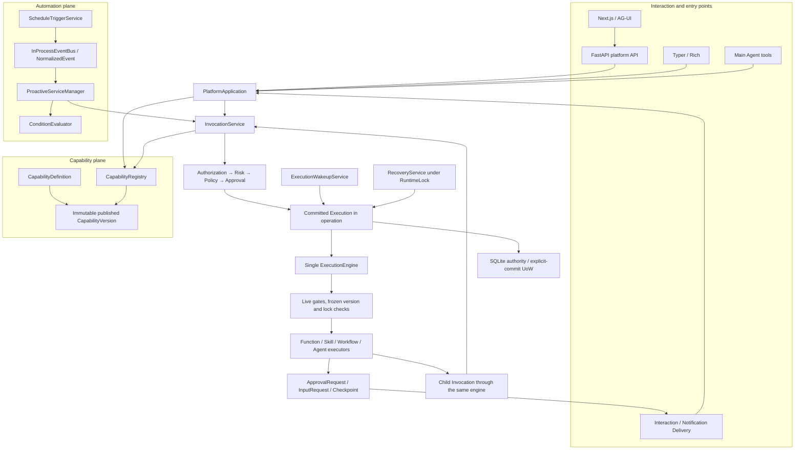

# Capability platform architecture

This describes the implemented Phase 4-12 platform, verified in Phase 13. It is
not a description of a second runtime or of every legacy Shovel subsystem.
See [ADRs](platform_adrs.md) and [final validation](platform_validation.md).

## Overall architecture

The existing Generic Host, dependency-injector composition, FastAPI application,
MAF Main Agent and statically exported Next.js workbench remain the foundation.
`runtime\service.py` composes one `Runtime`, one `InvocationService` and one
`ExecutionEngine`. The short-lived CLI Host is an alternative owner of the same
stores, not a second concurrent runtime; OS locks exclude competing writers.

In the online CLI path, `runtime\platform_client.py` sends the command to the
matching Host's HTTP API. Without that Host it uses the existing non-Web Host.
The diagram collapses this transport choice into the same application boundary.

`RuntimeWorker` dispatches platform Executions through this engine while retaining
the legacy Operation dispatcher. `AutomationWorker` owns process-local events and
business schedule polling. `ExecutionMaintenanceWorker` applies execution timers,
expires requests, refreshes interaction projections and delivers notifications.
Workers coordinate application services; they are not extra execution engines.

## Capability model

`capability\domain.py` defines Function, Skill, Workflow and Agent content.
Definitions own identity/name/description. Versions own executable content:
schemas, permissions and boundary, risk/effect metadata, approval requirement,
allowed capabilities, dependency lock, connection requirements and provenance.

Draft and Published distinguish publication. Deprecated, Disabled and Archived
are availability controls. Published **content** is immutable; separate
availability state can revoke execution without rewriting that content.
Editing a publication forks a new Draft with a new number. Publication requires
explicit human authorization; repository checks and SQLite triggers protect the
content hash, version identity and dependency records.

`CapabilityRegistry` resolves exact published versions and checks live
availability. Function implementations are identifiers in a trusted platform
catalog, never user-supplied Python module paths. The current production catalog
contains no external-write handler. The mock mail handler exists only inside
`backend\tests\test_platform_demos.py`.

Skills and Agent capabilities use isolated, tool-free MAF Agents with frozen
instructions and execution-scoped sessions. They do not inherit mutable workspace
extensions, Main Agent tools or Memory. Skill Memory Access is Disabled in V1.
Natural-language output is data, not code.

## Execution model

The physical `operation` table is reused as the sole new durable execution root.
There is no `ProactiveTask`, `WorkflowTask`, `SkillTask`, `FunctionTask` or
`AgentTask` table and no separate Invocation lifecycle table. Existing legacy
Job, Chat and Memory lifecycles have **not** been globally migrated into it.
Historical `FactTask` ORM scaffolding is not a new platform task engine.

`InvocationService` resolves the concrete version before admission, validates
input, narrows permissions and persists the immutable execution snapshot. This
includes the exact capability content/hash, exact dependency lock, invocation
context, Proactive Service revision snapshot and initial permission ceiling.

`ExecutionStateMachine` centralizes queued/running/suspended/terminal transitions.
Attempts and Steps record facts under the root. Parent/child/root IDs and
correlation IDs propagate through the same engine. Stable child keys prevent
checkpoint replay from creating another logical child. Budgets bound duration,
steps, children, depth, model turns and function calls; call paths reject
recursive capability calls.

Claim tokens, row versions and SQLite transaction boundaries protect state
changes. A checkpoint does not replace the version snapshot. If the frozen
version becomes unavailable, execution fails rather than silently switching.

## Permission model

Permissions are exact `(action, resource)` pairs, not wildcard strings.
`security\services.py` intersects all applicable sources:

- Configured user grants and platform constraints.
- Invocation and Main Agent ceilings.
- Capability, Proactive Service, Workflow and Skill boundaries.
- Parent permissions and the execution's frozen ceiling.

Required permissions must be a subset of the result. Live policy can remove
authority after admission; neither resumed execution nor child execution can
grow beyond its frozen/parent ceiling. Configuration is read-only authority;
browser options, request JSON, model text and approval tickets cannot grant it.
An empty configured grant set is default deny for permission-requiring work.

## Approval model

Permission answers whether execution is authorized. Approval answers whether an
already authorized execution needs human confirmation.

The gate order is Authorization, Risk, Policy, Approval, Execution. Risk has a
side-effect floor; external writes/destructive actions retain platform minimum
approval. User/service preferences are ALWAYS, RISK_BASED, EXTERNAL_ACTIONS or
MINIMUM_REQUIRED. There is no NEVER option. Any applicable requirement wins,
including an explicit Workflow Approval node.

ApprovalRequest is a durable fact bound to execution, scope and user, with
expiration, a gate-binding hash, one-time decision and one-time consumption.
Authorization and policy are checked again after approval. Repeated Workflow
checkpoints or child gates can legitimately require additional approvals;
approval of the root does not authorize every future child or checkpoint.

The entry layer adds a separate human confirmation preview for publish, enable/
resume, approval/rejection and input. Its process-local ticket is single-use,
lasts five minutes and binds exact command/resource state. Restart invalidates
these preview tickets, not the durable ApprovalRequest. Main Agent tools return
structured pending actions but cannot issue or consume human tickets. Plain
chat text such as "OK" is not consent.

## Proactive Service

`automation\manager.py` stores and matches configuration, evaluates declarative
conditions/mappings and submits an Invocation. It does not analyze an email,
generate a briefing or send anything itself.

Configuration contains trigger, conditions, target/version policy, input mapping,
permission boundary, approval preference, notification preference, quiet hours
and cooldown. Identity/display metadata, enabled/paused state and revision are
separate service fields. Save creates a disabled revision; explicit reviewed
enable/resume is necessary. Admission freezes that revision into Execution.

Exact and latest-published policies resolve concrete versions at admission.
Changing a service or publishing V2 never rewrites an existing execution.

Per-service pause stops future admission without changing its enabled flag.
Global pause is a workspace/user-scoped `AppSetting`, not a Task or new schedule.
It blocks automatic Event/Schedule admission, preserves individual states and
allows manual Run Now. Global resume rechecks enabled targets and advances the
schedule/event fence; skipped occurrences are not replayed. Existing Executions,
approvals, input requests and execution timers continue.

## Workflow

A Workflow is published Capability content, not a second version/lifecycle
system. V1 supports a serial acyclic graph of Input, Function, Skill, Condition,
Approval, Ask User, Notification, Emit Event and Output.

It has no Schedule/Event/Cron/Proactive trigger fields or nodes. Emit Event is an
execution step publishing a normalized event, **not** an external trigger.
Parallel, Join, fan-out, Loop, Script and BPMN compatibility are absent.

Publish validation checks graph structure/reachability, mappings, conditions,
input/output schemas, exact available dependencies, dependency cycles,
permissions, locks and risk/effect summaries. Function/Skill nodes invoke child
Executions through the same engine. Workflow state/checkpoint is persisted on
the existing root; there is no WorkflowTask runtime.

An Approval node suspends with `waiting_for_approval`. Ask User suspends with
`waiting_for_input`; the answer is bound to interaction/request ID, execution ID,
scope and user. Ordinary chat cannot answer a different execution. Failure edges
are explicit graph paths, not silent success fallbacks.

## Event reliability boundary

`InProcessEventBus` is bounded process-local transport with handler failure
isolation and graceful admission/drain/stop. Publishing acknowledges queue
admission, not durable delivery.

Only a committed Execution is durable. An event or schedule occurrence can be
lost before that commit. Occurrence/request identities deduplicate repeated
admission, but cursor updates and event delivery do not form a transactional
durable message broker. There is no Exactly Once guarantee. Explain/history
report admitted executions, not a complete ledger of skipped/lost events.

## Schedule Trigger versus Wakeup

Business schedules use `ScheduleTriggerService` and only publish events.
V1 supports interval and daily schedules, numeric UTC seconds and installed IANA
timezones. Daily spring-forward gaps are skipped; repeated local time uses the
first fold. Missed policy supports skip/grace and fire-once, not complete backlog
replay. Cron is not implemented.

Execution timers use `ExecutionWakeupService` and `execution_wakeups`. Delay and
Snooze suspend an existing Execution and persist `wake_at`; they never create a
Business Schedule. Retry uses bounded exponential backoff and an explicit
transient classification. Default automatic retry is bounded to three attempts,
with 1-second initial delay and 60-second cap.

Recovery runs under the existing RuntimeLock. Stale running attempts are fenced
and marked interrupted; waiting approval/input and timed suspensions recover.
Only read-only or explicitly retry-safe local work can replay. Dispatched,
non-idempotent external effects require reconciliation, not blind retry. Persisted
completed children are not repeated. Deadlines still bound waiting executions.

## Interaction and notification

ApprovalRequest is the approval fact. InputRequest is the bound answer fact.
Interaction is a user-facing projection: information, approval, input_request,
warning or result. Notification and NotificationDelivery are delivery records,
not authority or execution roots.

In-app delivery is persisted; console delivery uses literal Rich output.
Delivery retries are bounded, without cross-crash Exactly Once claims.

## Persistence and migration

Repositories own ORM/SQL. Application services use domain values and Protocols;
new UI, API, CLI and Agent entries never access ORM. `db\unit_of_work.py` provides
explicit commit, rollback/close protection and SQLite immediate write boundaries.
JSON uses SQLite-compatible TEXT encoding; nullable execution snapshots preserve
legacy SQL NULL behavior.

Schema versions 7-14 add the platform incrementally:

| Version | Change |
| --- | --- |
| 7 | Definitions, immutable versions, availability and locked dependencies |
| 8 | Execution snapshot/lineage/claims on `operation`; Attempt facts |
| 9 | Approval facts and consumption protection |
| 10 | Scoped idempotency, ownership/snapshot guards and Step facts |
| 11 | Proactive configuration/revisions and execution lookup index |
| 12 | Workflow checkpoint, input/notification foundations |
| 13 | Wakeups, recovery control, separate input/interaction/delivery records |
| 14 | Proactive display metadata and independent paused flag |

Uniqueness covers capability/version, scoped request identity, stable child
identity and approval consumption. Owner and query indexes support scoped
listing, expiration and due work. Ordered upgrades are repeatable and reject
invalid kernel ownership data rather than guessing an owner.

Phase 13 adds **no migration**. SQLite remains authoritative; existing knowledge
and Memory Zvec indexes remain derived and independently rebuildable.

## Credential references and security

Use ConnectionRequirement references or existing `identity_ref`/OS keyring/
environment references, not embedded credentials. Connection-backed capability
execution is currently rejected by policy: declaring a reference does not
enable a real external adapter.

Structured credential fields and SecretStr values are rejected in platform
payloads. This is not a guarantee of detecting secrets pasted into unrestricted
instructions/text, and historical stores were not scanned. Do not paste secrets
into definitions, Workflow mappings, model input, browser logs or test fixtures.
Diagnostics retain identifiers/counts/timings and exception types, not bodies.

This remains a loopback-only single-owner application. Host/Origin checks and
OS locks are not multi-user authentication, a sandbox for malicious local code,
or protection against a hostile process already running as the same user.
Legacy optional Python/MCP/workspace extensions remain outside this platform
gate boundary; Python extensions default off.

## Known limitations and future extensions

Legacy Operation/Job, Chat/Memory dispatch and some legacy ORM entry access still
exist. The new platform does not retroactively grant them kernel invariants.
Legacy extension imports/scripts are not exposed as new Capability executors.

UI/API support preference/quiet-hours editing and global automation control.
Current CLI/Main Agent tools do not expose all those editing/global commands.
Phase 13 verifies state agreement across their existing surfaces; missing
surfaces are deferred, not implemented behind a test helper.

No real mail send or other external-write adapter, arbitrary scripts, parallel
workflow engine, durable event broker, Skill Memory integration or permission
grant editor is included. Deterministic MAF transport fixtures validate
orchestration, not live model quality or all provider interoperability.

Future work should first restore the repository's existing dependency/format
baseline, then migrate legacy entry/lifecycle boundaries explicitly. Any real
external-write milestone needs credential resolution, effect receipts,
idempotency/reconciliation and adversarial gate tests before activation.
