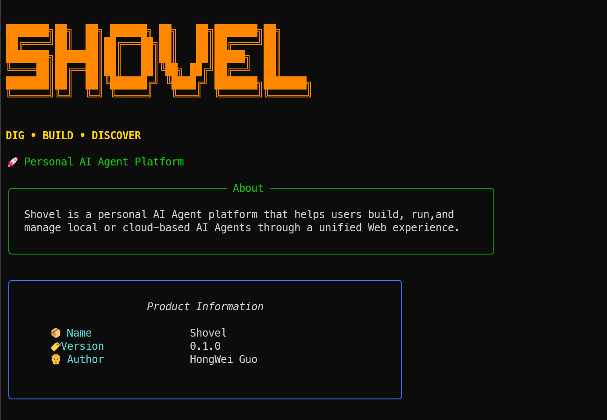
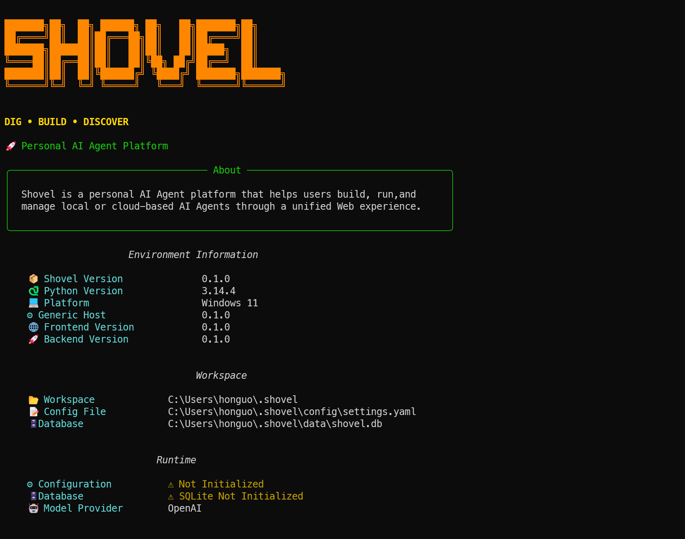

# `Hello, Shovel!`

`Shovel` is a personal AI Agent platform that helps users build, run, and manage local or cloud-based AI Agents through a unified Web experience.

Let's us Say :

```bash
uv run shovel version
```



Again, let us Say:

```bash
uv run shovel version --verbose
```



## Index recovery and cleanup

After configuring embedding, run `shovel scan run <resource>` to finish documents
previously scanned with `--no-embed` or interrupted during vector persistence.
Pending vectors and changed chunker/model versions also trigger reprocessing.
Use `shovel scan run <resource> --mode full_sweep --force` to rebuild all discovered
documents after an externally lost vector index; normal source filters still apply.

`shovel resource remove <resource>` persists a deletion intent before cleaning its
vectors. If cleanup fails, retry with `shovel scan cleanup`, optionally passing
`--resource-id <id>`. Cleanup does not require an embedding service.

Chunker v2 isolates chunk IDs by resource. Existing documents are reindexed on their
next scan, which incurs embedding work. See [the pipeline documentation](Documents/scan_pipeline.md)
for the recovery protocol and its limits.

## Run the local workbench

The current application includes resource management, durable background scans,
index recovery/cleanup, keyword/vector/hybrid retrieval, a persistent single-Agent
chat with numbered local citations, and opt-in Memory. The light Web workbench has
Resources, Background tasks, and Knowledge chat views. This is a single-owner
runtime, not yet a multi-Agent orchestration or scheduling platform.

Development requires Python 3.14+, Git, and Node.js 22.18+ (22 LTS in CI).
`py-generic-host` is pinned to a Git commit in both source and wheel dependencies;
no sibling checkout is required. On Windows, use **64-bit x64 Python** with the
committed Zvec 0.7 dependency; it can also run under x64 emulation on Windows ARM64.
Select it explicitly with `uv sync --python 3.14-x86_64 --locked --all-extras`.
The current lock does not include a native Windows ARM64 Zvec wheel. Do not mix
Windows and WSL virtual environments or source paths.

```powershell
uv sync --locked --all-extras --dev
uv run shovel init
Set-Location frontend
npm ci
Set-Location ..
uv run shovel run dev
```

`run dev` starts **two separate services**: Next.js on `http://127.0.0.1:3000`
and the Generic Host/FastAPI backend on `http://127.0.0.1:9999`. Next.js proxies
`/api/*` to the backend, so the browser uses same-origin REST requests. Top-level
configuration keys `dev_frontend_port`, `dev_http_host`, and `dev_http_port` control
these addresses. Both services stop when either exits or the command is stopped.

`run dev` also prints detailed backend diagnostics to the terminal: HTTP route,
status and duration, operation/job IDs, scan stages and counts, retrieval, model
calls, and Memory actions. Responses include `X-Shovel-Request-ID` for correlating
requests with these logs. Backend diagnostics omit request/response bodies,
credentials, document text and source paths. Next.js server output and browser
console logs are forwarded with the `web` prefix; browser console output is
forwarded verbatim, so do not log sensitive data there. These additional
diagnostics are scoped to `run dev`, not `run prd` or other CLI commands.
Normal production lifecycle and error logs are unchanged.

Production uses **only Python/FastAPI**, serving an already-exported frontend:

```powershell
Set-Location frontend
npm run build
Set-Location ..
uv run shovel run prd
```

Open `http://127.0.0.1:8080`. The production entry point never starts Node.js.
Static assets are resolved from `--frontend-dir`, the top-level `frontend_path`
configuration, bundled package assets, or the source checkout's `frontend\out`,
in that order. Release wheels bundle the frontend. A source-only Python build
must be given exported assets explicitly; missing assets cause a startup error.
The installed Host framework has no `app.frontend()` method, so Shovel provides
the equivalent `mount_frontend` adapter using FastAPI/Starlette static hosting.

Only loopback listeners are supported. Host/Origin checks prevent ordinary
cross-site browser access; this is not an authenticated, public, multi-user API.
Stop the running Host before reinitializing stores or changing storage settings.

## First knowledge loop, without model credentials

Use the Resources page to add a local directory, verify it, then scan with
embedding disabled. Markdown, text, PDF text layers, Word, Excel, and PowerPoint
are supported; scanned-image PDF OCR is not implemented. Knowledge chat includes
a standalone search view. Choose keyword retrieval to search the indexed text
without an LLM, embedding server, or GPU.

The same operation is available through the CLI:

```powershell
uv run shovel resource add notes --kind local_fs --set 'root_path=C:\Notes'
uv run shovel scan run notes --no-embed
uv run shovel scan list
```

### Local Outlook mail on Windows

Install the optional integration with `uv sync --locked --extra outlook` (or
`--all-extras`), open **classic Outlook** with your normal profile, and run Shovel
in the same logged-in Windows user session. New Outlook, unattended Windows
services, and direct parsing of raw PST/OST files are not supported. PST archives
already mounted in classic Outlook can be selected like other stores.

In Resources, choose **Classic Outlook mail (Windows)**, select a mailbox and
explicit folders, then add/verify and scan. Subfolders are opt-in. The same
resource works through the existing CLI:

```powershell
uv run shovel resource outlook-stores
uv run shovel resource outlook-folders --store-id "<StoreID>"
# Add --parent-id "<FolderID>" to browse children.
uv run shovel resource add mail --kind outlook_local --config-json '{"store_id":"<StoreID>","folder_ids":["<FolderID>"],"include_subfolders":false}'
uv run shovel resource verify mail
uv run shovel scan run mail --no-embed
```

Mail headers and readable cached text bodies are indexed, including searchable
sender/recipient context and source metadata. Attachment names/sizes are recorded,
not attachment contents. No mail is sent, moved, deleted, marked read, or saved.
Outlook permissions/security prompts are not bypassed. Header-only, empty, changed,
or unreadable messages produce visible failures; download full messages in Outlook
and retry. Outlook/provider activity may still involve network access.

**Deleting mail in Outlook does not delete its indexed Shovel copy.** Automatic
deletion detection is deliberately disabled, including full sweeps. Remove the
Shovel resource and clean its index to erase its indexed contents; this never
deletes original mail. Remote embedding/chat providers receive mail excerpts when
used. See [Outlook integration](Documents/outlook_local.md) for identity, filtering,
worker isolation and testing details.

All resource mutations, scans, and cleanup use the same Host-owned background
queue. With a running backend, the CLI submits REST requests and waits for a
durable operation receipt. Otherwise it starts a short-lived, non-Web Host.
Read-only CLI queries use SQLite directly. OS locks protect the database and
vector directory from competing runtime writers.

Operations and scan parameters survive restart. Interrupted work resumes with the
same Job ID; cancellation, partial failure, retries, discovery progress, and job
events are visible in Background tasks. Deleting a resource keeps its operation
receipt and durable vector deletion intents even after its metadata is gone.

## Configure chat and semantic retrieval

Edit the TOML file printed by `shovel init`, or set nested environment variables,
for example `SHOVEL_MODEL__SECURITY_KEY`. Merge the following into the existing
configuration rather than duplicating table headings. Restart the Host after
changing configuration.

For a local Ollama model that you have already downloaded:

```toml
[model]
model_provider_type = "ollama"
base_endpoint = "http://127.0.0.1:11434"
model_name = "qwen3:4b"
max_input_chars = 24000
max_output_tokens = 2048
timeout_seconds = 120
```

Shovel does not install Ollama, download models, or manage GPU drivers. The
character budget bounds history, retrieved evidence, and recalled Memory;
it is not a tokenizer-based context-window guarantee. Lower it for small models.
OpenAI-compatible services use Chat Completions with `max_tokens`; models requiring
a different API or token-limit parameter are not interchangeable without an adapter.

Supported chat adapters include OpenAI, DeepSeek, Qianwen, Kimi, Ollama, and Azure
OpenAI-compatible deployments. OpenAI-compatible `base_endpoint` includes `/v1`
where required; Ollama uses the server root. Azure uses the resource endpoint,
deployment name in `model_name`, and `api_version`. `azure_foundry` currently means
this same deployment API, not the Foundry hosted-agent protocol. The
`microsoft_copilot` provider requires an explicit compatible endpoint and credential;
it does not provide a Copilot subscription login flow.

Knowledge embeddings are configured separately under `[embedding]`, not inferred
from the chat model. Its `provider` can be `openai`, `azure_openai`, or `ollama`;
set `model`, `base_url`, and any required `api_key`/`api_version`. Its output
dimension must match `zvec.dim`. Initialize the vector collection with
`shovel init` before vector scans/searches. Changing dimension requires a new
knowledge-store path and reindexing, not editing the dimension of an existing store.

`auto` retrieval uses hybrid search when embeddings are configured, otherwise
keyword search. `keyword`, `vector`, and `hybrid` can also be selected explicitly.
Hybrid uses reciprocal-rank fusion; SQLite remains authoritative for resource
visibility, document revision, and citation text. Revoked/deleted resources are
excluded. Pausing stops scanning but does not hide previously indexed knowledge.

Chat persists both turns and actual referenced source excerpts. An invalid
source number fails the answer explicitly; absent evidence or omitted citations
produce a warning. Number validation does not prove that every model claim is
supported: inspect the citation excerpts. Remote chat/embedding providers receive
the question and relevant excerpts; use local models for fully local processing.
Answers are currently non-streaming and there are no Agent tools or multi-Agent
execution.

## Opt-in Memory

Memory is disabled by default for each chat request. Enabling it requires an
explicit `[memory.embedder]` model and either `[model]` or `[memory.llm]`.
Memory uses mem0 and its own Qdrant collection, independent of the Zvec knowledge
index; its embedding dimension must match `memory.dim`.

For fully local Memory, explicitly set `memory.embedder.provider = "ollama"` and
its `model`/`base_url`; set `[memory.llm]` similarly or inherit the Ollama chat
model. When changing Memory dimensions, select a new collection and initialize
it instead of overwriting the existing collection.

When enabled, Memory recalls user background before answering and extracts
memories from **only the user's message**, never retrieved documents or generated
answers. Recalled Memory is not a local-document citation. The workbench exposes
list/forget controls. Memory errors are visible; a write failure keeps the
generated answer but attaches a persisted warning.

The current fixed owner scope is `local-user` / `shovel`; there is no multi-user
identity system. Deleting a Memory item removes that mem0 record, not the source
message from persisted conversation history or storage backups. Configured remote
Memory LLMs/embedders receive user text; Qdrant can be local, server, or cloud as
configured.

## REST surface

The live API reference is `/docs`, with schema at `/openapi.json`.
Routes are under `/api/v1`; collection responses use `{"items": [...]}`.
Mutating resource/scan/cleanup requests return **202 + an Operation**, not a
completed resource. Poll `/operations/{id}` for the result.

| Surface | Endpoints |
| --- | --- |
| Runtime | `GET /status`, `GET /connectors` |
| Local Outlook | `GET /outlook/stores`, `GET /outlook/folders?store_id=...&parent_id=...` |
| Resources | `GET/POST /resources`, `GET/PATCH/DELETE /resources/{id}` |
| Resource actions | `POST /resources/{id}/verify`, `/pause`, `/resume`, `/revoke`, `/scans` |
| Profiles | `GET /resources/{id}/profiles`, `PUT/DELETE /resources/{id}/profiles/{name}` |
| Named commands | `POST /commands` carries `kind`, `ref`, `payload` without putting resource names in URL paths |
| Work | `GET /operations`, `GET /operations/{id}`, `POST /operations/{id}/retry` |
| Scans | `GET /jobs`, `GET /jobs/{id}`, `GET /jobs/{id}/events`, `POST /jobs/{id}/cancel` |
| Index | `GET /index/cleanup`, `POST /index/cleanup`, `POST /search` |
| Chat | `GET/POST /conversations`, `PATCH/DELETE /conversations/{id}`, `GET/POST /conversations/{id}/messages` |
| History | `POST /history/prune` explicitly prunes bounded, old terminal history |
| Memory | `GET /memories`, `DELETE /memories/{id}` |
| Credentials | `POST /credentials` writes the OS keyring and returns an `identity_ref` |

Source text and paths are shown as citation data; there is no API for opening an
arbitrary filesystem path. Raw resource credentials must not appear in queued
config/payloads; use `identity_ref`. Model credentials remain in local
configuration/environment variables and should not be committed.

## Reliable submissions and profile management

All durable writes accept `Idempotency-Key` (1–128 ASCII letters/digits or
`._:-`). Reusing a key for the same normalized request returns its original
receipt, even after resource/profile deletion; different arguments return 409.
Do not use a new key just because a response was lost. Chat generation and
Memory writes do not promise exactly-once execution.

The CLI records a local receipt before submission and accepts a global key:

```powershell
uv run shovel --request-key notes-scan-001 scan run notes --no-embed
uv run shovel operation requests
uv run shovel operation list
uv run shovel operation show <operation-id>
uv run shovel operation wait <operation-id>
uv run shovel operation retry <operation-id>
```

`wait` reconnects to the existing operation, starting a non-Web Host if needed.
Interrupted browser writes stay in workspace-scoped browser storage; Background
tasks can find their receipt or resend the exact request with its original key.
Resource/profile request bodies may contain local paths; clearing browser site
data removes these local recovery records, not server-side operations.

`shovel profile list notes` lists persisted profiles. Use
`shovel profile save notes text --file profile.json` to replace/upsert one:

```json
{"include":["*.txt"],"exclude":[],"scan_mode":"full_sweep","pipeline":{}}
```

Choose it with `shovel scan run notes --profile text --no-embed`, or the scan
form in Resources. The Web profile editor exposes the same validated JSON.
Supported processing settings are `pipeline.chunker` budgets and
`pipeline.parser.max_chars`. Unknown keys and invalid budgets are rejected.
Queued/running scans block profile mutation. Overlapping profiles must use the
same pipeline: each resource/document has one shared representation, not an
independent index per profile.

Full sweeps reconcile membership only within their profile. A document is
tombstoned only when no other profile owns it. Removing a non-default profile
also removes its scan history and its exclusively owned index entries, never
the source files. Vector cleanup failures retain deletion intents and a
retryable receipt. The default profile can be changed/disabled, not deleted.

Local filesystem discovery always enumerates metadata; timestamps are not
reliable cursors. Same-second edits and newly copied files with old timestamps
are therefore discovered. Root/walk/stat failures fail the job without deletion
reconciliation. Complete discovery plus `DELETE_DETECT` is required for deletion.
Fingerprints are size + nanosecond mtime, not cryptographic content hashes;
deliberately restoring both after editing requires `--force`.

Parser versions, parser/chunker settings and chunker defaults invalidate old
processing automatically. Embedding identity also includes endpoint, API version,
dimension, input limit and optional `embedding.revision`; rotating credentials
does not rebuild the index. Use `revision` when replacing weights behind an
unchanged model/deployment name. Runtime configuration reads environment over
TOML over defaults; `AppSettings.load()` intentionally reads the file only.

## Explicit history maintenance and quality baselines

Conversation messages use `limit` (default 100, max 1000) and `before` sequence
pagination; the response includes `next_before`. The workbench exposes older
messages, conversation paging, renaming and confirmed deletion. Deletion removes
messages, not independently saved Memory, and is refused during generation.

`shovel history prune --keep-days 30 --limit 1000` asks for confirmation before
pruning old terminal Jobs/events, unkeyed Operations, retrieval logs and completed
cleanup records, bounded per category. Active work, pending cleanup, documents,
conversations and keyed receipts are retained. Background tasks exposes the same
confirmed action. Keyed receipts are deliberately retained to prevent a formerly
used request key from executing again. No automatic retention policy is enabled.

Quality gates run Ruff, mypy, pytest (including actual process termination against
SQLite/Zvec), frontend lint/types/tests/build, and clean installed-wheel startup,
REST/CLI/search and shutdown. Dependency installation uses the committed locks.

`backend/tests/fixtures/knowledge` contains fixed synthetic Chinese evidence.
The offline baseline checks keyword recall@3 and revoked-resource visibility.
The opt-in live baseline checks real hybrid recall, required answer facts,
citations and insufficient-evidence behavior using isolated temporary stores:

```bash
export SHOVEL_RUN_LIVE_TESTS=1
export SHOVEL_LIVE_CONFIG=/path/to/settings.toml
export SHOVEL_BASELINE_REPORT=/path/to/baseline.json
uv run pytest backend/tests/test_knowledge_baseline.py -m live --no-cov
```

Select both chat and embedding providers explicitly before running; external
providers receive the synthetic evidence and may charge for calls. The JSON
report records measured baseline results, not a general model-quality guarantee.
Agent tools, cron/watch scheduling and multi-Agent workflows remain future work.
